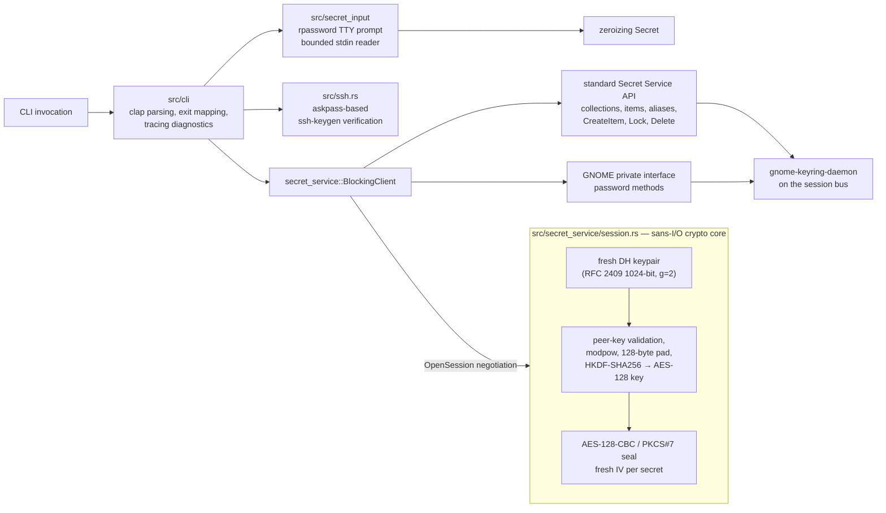

# gmellon

> *mellon* — "speak, friend, and enter."

`gmellon` is a small Rust CLI that speaks GNOME Keyring's private D-Bus
password interface, so you can **list, unlock, lock, and re-key any GNOME
keyring collection from a shell** — no GUI, no PAM, and no display server —
and **store your SSH key passphrases exactly where gcr-ssh-agent reads
them**. A `gnome-keyring-daemon` Secret Service must be available on the
session bus.

It exists because every other door is shut on a headless, SSH-only machine:

| Door | Why it's shut |
|---|---|
| GUI prompter (`gcr-prompter`) | needs X/Wayland; D-Bus activation fails without one |
| `gnome-keyring-daemon --unlock` | never forwards to a *running* daemon; tries to become its own daemon and collides with systemd's socket |
| `pam_gnome_keyring` | module not installed here; only fires on password logins; only works if keyring password == account password |
| `secret-tool` | has `lock`, has `search --unlock`, but **no `unlock` command** — unlocking is deliberately prompt-gated |
| Secret Service `Unlock()` D-Bus call | returns a *prompt object*; prompts are GUI |

GNOME Keyring's Secret Service also exposes the deliberately undocumented
`org.gnome.keyring.InternalUnsupportedGuiltRiddenInterface`, whose
`UnlockWithMasterPassword`, `ChangeWithMasterPassword`, and
`CreateWithMasterPassword` methods accept a collection's master password
from any D-Bus client — headless, no prompt, and per collection rather
than only `login`. `gmellon`'s collection-oriented Rust client
([`src/secret_service`](/src/secret_service)) speaks it; the isolated
private-broker harness proves listing, unlocking, and re-keying multiple
collections with distinct passwords by stable ID, without ever locking a
collection to verify a password
([`doc/harness/collections0.glm53max.md`](/doc/harness/collections0.glm53max.md)).
Treat it exactly as GNOME names it: an internal, **unsupported** interface
that may change or vanish without notice. The standard Secret Service API
still offers no supported headless password entry.

Password transport uses the standard encrypted Secret Service session
(`dh-ietf1024-sha256-aes128-cbc-pkcs7`), negotiated on every connection
with a fresh Diffie-Hellman keypair; each password is sealed with a fresh
random IV and never crosses the bus in the clear. There is deliberately no
plain-session fallback: a Secret Service that lacks that algorithm fails
with a clear error rather than downgrading. The isolated private-broker
harness proves it with a bus monitor that scans every password-method
message body for the generated passwords and finds only ciphertext
([`doc/harness/session0.gpt6a.md`](/doc/harness/session0.gpt6a.md)).

Current implementation, verification, security boundaries, and remaining work
are summarized in [`doc/status.md`](/doc/status.md).

## Install

From a checkout:

```sh
cargo install --path /path/to/gmellon
```

The default build is the complete CLI. The historical login control-socket
backend is **not** included by default; see
[Backend policy](#backend-policy) for `--features login-control`.

A crates.io release is pending an operator decision — the release blocker
(encrypted transport) and the packaging boundary are both closed, so
publishing is unblocked.

## Usage

Omitted collection IDs default directly to `login`; there is no
configuration layer or environment-selected default.

### Collections

Discover what exists, then act on one collection at a time by its stable
ID:

```sh
# list stable collection IDs, mutable labels, and lock state
gmellon list

# prompt-free service health report: capabilities and lock states;
# never prompts, never unlocks or locks, never calls a password method
gmellon status

# unlock the login collection; password prompted on the TTY, no echo
gmellon unlock

# unlock another collection by stable ID
gmellon unlock work

# scripting: read a single line (sans newline) from stdin
gmellon unlock work --stdin < /dev/shm/pw

# lock a collection — an explicit state change, prompt-free
gmellon lock work

# rotate a collection password (prompts for current + new + confirm)
gmellon change work

# scripting: current, new, and confirmation lines in that order
gmellon change work --stdin < /dev/shm/password-change
```

The safety rails around this group are proven, not promised:

- An already-unlocked collection returns success **without reading or
  checking a password**; an already-locked collection returns success
  without a Lock call.
- Ordinary unlock never locks or relocks a collection to verify one; lock
  is its own explicit command and nothing ever calls it implicitly.
- A denied current password during `change` leaves the old password valid.

### SSH key passphrases

gcr's SSH agent (the `SSH_AUTH_SOCK` you get on a modern GNOME session)
reads key passphrases from the keyring, keyed by the key's absolute path.
This group stores, finds, and removes exactly those entries:

```sh
# store an SSH key passphrase — prompted for the KEY's passphrase
# (not the keyring password), verified against the key first
gmellon ssh-add ~/.ssh/deck

# scripting: read the passphrase from one stdin line instead
gmellon ssh-add ~/.ssh/deck --stdin < /dev/shm/pw

# list every stored key passphrase across all collections
# (metadata only: the passphrases are never read)
gmellon ssh-list

# remove a stored passphrase (the key file itself may be long gone)
gmellon ssh-remove ~/.ssh/deck

# also grant the askpass helper permission to answer for this key
gmellon ssh-add ~/.ssh/deck --askpass

# grant or revoke that permission on an already-stored key
gmellon ssh-allow ~/.ssh/deck
gmellon ssh-deny ~/.ssh/deck
```

The `ssh-add` contract, in order:

1. **Verify before store.** The passphrase is checked by running
   `ssh-keygen -y` against the key through gmellon's own askpass helper —
   the passphrase never appears in argv, the environment, or a file. A
   wrong passphrase exits 2 and stores nothing; an unencrypted key exits
   1 (a deliberately wrong probe also decrypts it — there is nothing to
   store).
2. **Store where gcr looks.** The item goes to the collection the
   service's `default` alias resolves to (an unset alias is refused with
   an explanation rather than storing somewhere unreadable), keyed by
   `unique=ssh-store:<absolute path>` with the generic-schema attribute
   gcr's lookup matches, labeled `Unlock password for: <basename>`, and
   sealed under the encrypted session (the harness's CreateItem body
   monitor proves ciphertext-only on the wire).
3. **Replace, never duplicate.** Storing again for the same key rotates
   the stored passphrase.

`ssh-remove` deletes the single exactly-matching item; duplicates (which
gcr cannot disambiguate either) are reported without changing anything.

#### The askpass helper

OpenSSH asks for key passphrases by execing the program in `SSH_ASKPASS`
with the prompt as its only argument and reading one line from its stdout
(OpenSSH 8.4+ can force this anywhere with `SSH_ASKPASS_REQUIRE=force`).
gmellon can be that program, answering from the same stored items gcr
reads — headless `ssh`, `ssh-add`, and `git`-over-ssh included:

```sh
# one-time setup: expose the binary under its multicall name
ln -s "$(command -v gmellon)" ~/.local/bin/gmellon-askpass

# then answer prompts from the keyring
export SSH_ASKPASS=gmellon-askpass SSH_ASKPASS_REQUIRE=force
ssh somewhere.example
```

Nothing is answerable by default. A key becomes answerable only when its
stored item carries the `gmellon:askpass=allow` attribute (`ssh-add
--askpass`, or `ssh-allow` on a stored key), because an askpass program is
a passphrase oracle: any local process can invoke it directly with a
forged prompt. The helper therefore never prompts (a locked keyring is a
refusal, not a hang), never answers OpenSSH's yes/no confirmation prompts
(`SSH_ASKPASS_PROMPT=confirm`), and refuses everything else with exit 1
and an empty stdout. Wrapper scripts that cannot carry a second binary
name can use the hidden subcommand instead:
`SSH_ASKPASS` → a script running `exec gmellon __askpass "$1"`.
The full contract and threat model: [design/askpass/askpass.glm53.md](design/askpass/askpass.glm53.md).

### Keyring items

Generic, metadata-only inspection of what a collection holds:

```sh
# list a collection's items: labels, lock state, sorted attributes
# — no secret is ever read
gmellon items work
```

`ssh-list` is this view filtered to gcr's `ssh-store:` items across all
collections.

### Diagnostics and completions

```sh
# redacted diagnostics on stderr: operations, results, lengths only —
# never password bytes or key material
gmellon -v unlock work

# shell completions (zsh shown; bash, elvish, fish, powershell also built in)
gmellon completions zsh > ~/.zfunc/_gmellon
```

zsh users generally want the [zimfw module](#zsh-integration-zimfw-module)
instead: it installs and regenerates the completion automatically.

### Secret input contract

Every password and passphrase — collection passwords for `unlock` and
`change`, key passphrases for `ssh-add` — enters through the same narrow
door:

- **TTY (default)** or **one `--stdin` line**. Never argv or flags — argv
  is world-readable in `ps` — and never environment, config, or files.
- The `--stdin` contract: exactly one line, terminated by LF or CRLF —
  input ending without a newline is an error (an empty pipe included; an
  empty line is a valid empty password). Input must be valid UTF-8 —
  invalid bytes error rather than being replaced. Every byte before the
  terminator is literal content: no line editing is applied, so backspace
  and control bytes from a pipe are data, not commands. Input is capped
  at 64 KiB. `change --stdin` reads three lines: current, new,
  confirmation.
- With no controlling terminal the TTY prompt fails with an actionable
  error suggesting `--stdin`.
- Secret values and secret-bearing buffers use best-effort zeroization
  when dropped; command paths drop them promptly after each exchange.
  This cannot erase copies abandoned by dependency internals or allocator
  behavior.

### Exit codes

| code | meaning |
|---|---|
| 0 | OK — including already-unlocked and already-locked no-ops |
| 1 | usage, input, missing collection/key, encrypted-session failure, or unexpected local/D-Bus error |
| 2 | DENIED — wrong password or passphrase |
| 3 | GNOME's private password interface is unavailable |
| 4 | session bus or GNOME Secret Service is unavailable |

The exit table is a contract; new failure modes fold into the existing codes
(for example, both encrypted-session failures and a lock that would demand an
interactive prompt exit 1 with distinct messages).

## Security model

- **Encrypted transport, always.** Every connection negotiates the standard
  `dh-ietf1024-sha256-aes128-cbc-pkcs7` Secret Service session with a fresh
  per-connection DH keypair; every password is sealed under a fresh random
  IV. No plain session is ever negotiated, silently or otherwise. The
  protocol's group (RFC 2409 1024-bit MODP) and cipher mode (CBC, not an
  AEAD) are dated; they are what the spec offers, mitigated by fresh
  exponents, per-secret IVs, and gmellon's strict peer-key validation —
  which the daemon itself lacks.
- **Secrets enter through one narrow door.** TTY (echo disabled) or one
  bounded stdin line. Never argv, environment, config, or retained
  artifacts — including on the way *out* to helper processes: key
  passphrase verification runs ssh-keygen through gmellon's askpass
  helper rather than `-P` argv. Secret types expose only borrowed bytes
  and implement none of `Debug`, `Clone`, or `Display`.
- **No side effects you didn't ask for.** Unlock never locks or relocks to
  verify a password. Lock is its own explicit command. Status never calls
  a password method. `ssh-add` refuses rather than store unverified or
  where it could not be found. Loading the zsh module never prompts and
  never runs `systemctl`.
- **Fail closed.** An algorithm-rejecting service, a demanded prompt object,
  an out-of-range peer key, malformed monitor output — each fails with a
  clear error rather than degrading.
- **Best-effort memory hygiene, honestly stated.** Zeroized exponents,
  keys, IVs, padded buffers, and frames; but zbus, the broker, the daemon,
  and the allocator hold copies gmellon cannot erase. Bus components
  legitimately see ciphertext and metadata (paths, lengths, algorithm).

## Architecture



The design rule that shapes it: **I/O and cryptography never mix**. The
session core in [`src/secret_service/session.rs`](/src/secret_service/session.rs)
is pure computation over byte slices — no zbus types — so the blocking
client and a future Tokio adapter share it verbatim, and every constant and
derivation step is pinned by known-answer tests (including the
prime-length shared-secret normalization that silently breaks naive
implementations).

| Area | Path | Responsibility |
| --- | --- | --- |
| CLI | [`/src/cli/mod.rs`](/src/cli/mod.rs) | clap parsing, subcommand dispatch, redacted `-v` tracing, exit mapping |
| Secret input | [`/src/secret_input/mod.rs`](/src/secret_input/mod.rs) | rpassword TTY prompts, bounded stdin records, confirmation, zeroizing ownership |
| Session crypto core | [`/src/secret_service/session.rs`](/src/secret_service/session.rs) | DH keypair, peer-key validation, HKDF-SHA256 derivation, AES-CBC sealing — sans I/O |
| Collection client | [`/src/secret_service/`](/src/secret_service/) | encrypted-session negotiation, collection/item metadata, aliases, generated zbus proxies, list/status/unlock/lock/change/items/ssh-*, error classification |
| SSH key verification | [`/src/ssh.rs`](/src/ssh.rs) | askpass-based `ssh-keygen` verification of key passphrases without argv exposure |
| Historical control backend | [`/src/control/`](/src/control/) | login-only control-socket codec and client, behind `login-control` (off by default) |
| Executable harness | [`/dev/harness/`](/dev/harness/) | private dbus-broker + daemon lifecycles, checks, teardown, retained evidence |
| Rust proofs | [`/tests/harness/`](/tests/harness/) | real-daemon transport, collection, binary CLI, wire-monitor, and redaction proofs |
| Zsh module | [`/zimfw/`](/zimfw/) | SSH agent socket selection, completions regeneration — never prompts |

### Durable decisions

- Collections are addressed by stable D-Bus ID, with `login` as the fixed
  omitted-argument default.
- No configuration layer for a single default value.
- Passwords and passphrases never enter argv, environment, config, files,
  or retained evidence — in the product or in its tests.
- Ordinary unlock never locks or relocks; lock is always explicit.
- Key passphrases are verified against the key before anything is stored,
  and stored exactly where gcr-ssh-agent will read them.
- Never a silent fallback: not to a plain session, not to the create-capable
  control backend.
- Sync product APIs today; the sans-I/O crypto core and generated async
  zbus proxies keep a Tokio sibling cheap when one is wanted.

### Backend policy

The collection-oriented zbus client is the default product backend. The
proven login control socket is available through the `login-control` Cargo
feature, disabled by default. Enabling it (for example
`cargo build --features login-control`, or by adding the feature to the
`gmellon` dependency) exposes the library-only
`gmellon::control::LoginControlClient` with `unlock_login` and
`change_login_password`; no CLI command selects it, and there is no fallback
path — the control backend is never used automatically or silently.

Its honest limits stay visible at the API: it can address only the special
`login` collection; UNLOCK and CHANGE can create a missing login keyring
encrypted with the supplied password; and an OK result cannot distinguish an
already-unlocked keyring from a newly unlocked one. It is retained machinery
with different semantics, not an alternative default backend.

## Zsh integration (zimfw module)

The [`zimfw/`](/zimfw) directory is a self-contained zsh module that exports
a validated `SSH_AUTH_SOCK` in the loading shell. It is shell-local and
idempotent: **loading it never prompts for a password, never locks or
unlocks anything, and never invokes `systemctl`** — environment setup stays
fully separate from unlocking.

Add one line to `~/.zimrc`:

```zsh
zmodule rektide/gmellon --root zimfw
# or, for a local checkout zimfw should never install or update:
zmodule /path/to/gmellon/zimfw
```

The module's init file is `init.zsh`, zimfw's default discovery name, so no
`--source` is needed in either form.

Selection priority: an explicit `GMELLON_SSH_AUTH_SOCK` override (must be an
existing socket, otherwise an actionable error and no change) → an existing
`SSH_AUTH_SOCK` that still resolves to a socket (never clobbered; repeated
loads are stable) → discovery of `$XDG_RUNTIME_DIR/gcr/ssh` then
`$XDG_RUNTIME_DIR/keyring/ssh` → an actionable, non-fatal message when
nothing validates.

Publishing to the systemd user manager is opt-in and explicit:
`gmellon-ssh-auth-sock-publish-systemd` reads `systemctl --user
show-environment` and only sets `SSH_AUTH_SOCK` when absent there,
preserving any existing value exactly and reporting an unavailable user
manager without changes.

**Completions:** when a `gmellon` binary is on `PATH`, module load also
keeps `functions/_gmellon` current — regenerating it from
`gmellon completions zsh` whenever the binary is newer than the file
(the zimfw convention: the module's `functions/` directory is on `fpath`
automatically). Without a `gmellon` binary the module skips this silently;
the SSH environment work is unaffected.

### Opt-in: unlock at shell login

The module above deliberately handles only the environment. Unlocking is a
password operation and stays fully opt-in — if you want your login keyring
unlocked from your first interactive shell, add this to `~/.zshrc`:

```zsh
# prompt only when the login keyring is actually locked
if [[ -o interactive ]] && (( $+commands[gmellon] )); then
  gmellon unlock
fi
```

This is safe unconditionally: `gmellon unlock` on an already-unlocked
collection exits 0 **without reading a password** (proven in the private
broker harness), so the first shell after login prompts once and every later
shell is a silent no-op. A wrong password exits 2 and the next shell simply
tries again. The `[[ -o interactive ]]` guard keeps non-interactive shells
(scp, CI, hooks) away from the TTY prompt entirely.

Details and the zsh test suite: [`zimfw/README.md`](/zimfw/README.md).

## Development

The maintained harness and evidence are intentionally more substantial than
the small product path, because they prove isolation, lifecycle, and
secret-handling claims against real external processes: a private
`dbus-broker`, a manually launched `gnome-keyring-daemon` with redirected
`HOME`/XDG storage, streaming bus monitors that scan every password-method
and CreateItem message body for generated secrets, fixture readback of
stored secrets through a gcr-style encrypted GetSecret, and redaction scans
over every retained binary stream and artifact. The harness is
configuration/session isolation, not a security sandbox; exact boundaries
and evidence live in [`doc/harness/README.md`](/doc/harness/README.md), with
the current verification matrix in [`doc/status.md`](/doc/status.md).

Ordinary checks:

```sh
cargo nextest run                            # 98 passed, 2 skipped
cargo nextest run --features login-control   # 125 passed, 4 skipped
cargo clippy --all-targets --all-features -- -D warnings
cargo fmt --check
zimfw/test.zsh                               # 68 assertions
```

Maintained external proofs (each fails with status 125 when its hard
prerequisites are absent):

```sh
dev/harness/check rust-nextest  # control backend against the real daemon (feature-enabled)
dev/harness/check rust-broker   # collection client proof under the private broker
dev/harness/check rust-cli      # compiled CLI proof: list/status/unlock/lock/change/items/ssh-*
dev/harness/check broker        # private-broker lifecycle and interface suite
dev/harness/check all           # everything above plus Python suites
```

Encrypted test-key fixtures are generated under a pty (prompt-synchronized,
in Rust — no scripting-language dependency), so fixture passphrases never
touch argv, the environment, or the disk either.

### Crates

| crate | use |
|---|---|
| clap v4 (derive) + clap_complete | CLI + completions |
| rpassword | no-echo TTY prompts |
| zeroize | clear password and request buffers after use |
| rustix | effective and peer UID checks (net/process features only under `login-control`) |
| zbus | Secret Service discovery, items, aliases, Lock, and GNOME private password methods |
| crypto-bigint | 1024-bit DH modpow (Montgomery ladder, zeroized exponents) |
| sha2 + hkdf | HKDF-SHA256 session-key derivation |
| aes + cbc | AES-128-CBC sealing with PKCS#7 padding (dev: fixture secret readback) |
| getrandom | DH private exponents and per-Secret IVs |
| tracing + tracing-subscriber | redacted `-v` operation diagnostics |
| nix (dev) | pty fixture-key generation |

Publishing: `cargo bump` + `jj commit` + `cargo publish` when it earns it.

## Behavior notes (the sharp edges)

- **The private interface is unsupported upstream.** It may change or vanish
  without notice; gmellon detects its absence and reports it distinctly
  (exit 3). Locked-collection password change is confirmed against
  `gnome-keyring-daemon` 48.0 and is version-scoped evidence, not a
  promise.
- **Item storage is only as gcr-compatible as the service's default
  alias.** `ssh-add` stores in the collection `ReadAlias("default")`
  resolves to, because that is where gcr-ssh-agent's libsecret lookup
  reads; a service with no default alias is refused rather than written.
- **No rate limiting or lockout exists server-side.** A wrong password just
  returns DENIED, from any client on the session bus — same trust boundary
  the bus itself has.
- **Evidence is host-scoped.** Proofs ran against daemon 48.0, systemd 261,
  and dbus-broker 37; monitor parsing is pinned to the installed `busctl`
  rendering and fails closed on unexpected shapes. Key-passphrase
  verification behavior is OpenSSH's `ssh-keygen -y` semantics.
- **TTY behavior** is covered through rpassword's injected-reader seam; the
  maintained real-daemon binary proofs use `--stdin`.

## Appendix: the login control protocol

The first implementation used GNOME Keyring's private control socket. It is
retained as tested machinery behind the optional, disabled-by-default
`login-control` Rust feature — library-only, with no CLI selection path (see
[Backend policy](#backend-policy)). It can address only the special `login`
collection, its UNLOCK/CHANGE may **create** a missing login keyring with
the supplied password, and its OK result cannot distinguish already-unlocked
from newly unlocked. Those semantics — not just the transport — are why it
is not the default backend.

Transport: `AF_UNIX` `SOCK_STREAM` at `<control-dir>/control`,
default control dir `$XDG_RUNTIME_DIR/keyring`.

Immediately after connecting, the client writes one NUL credential byte. The
daemon consumes it separately from the frame and verifies that the peer UID
matches its own (on Linux via `SO_PEERCRED`). This byte is not included in
the frame length. A client should also verify that the socket and connected
peer belong to its effective UID before sending a password.

All integers are **u32 big-endian**. Strings are u32 BE length + raw bytes,
with no NUL terminator or interior NUL. GNOME's `EggBuffer` rejects string
lengths greater than or equal to `0x7fffffff`. The leading length field counts
the whole frame, including itself.

```
request:  [u32 total_len][u32 op][payload...]
response: [u32 total_len][u32 result]
```

| op | value | payload |
|---|---|---|
| INITIALIZE | 0 | stringv (env) — not used by gmellon |
| UNLOCK | 1 | string: password |
| CHANGE | 2 | string: original, string: new |
| QUIT | 3 | — |

| result | value |
|---|---|
| OK | 0 |
| DENIED | 1 |
| FAILED | 2 |
| NO_DAEMON | 3 |

Example: `unlock` with password `mellon` (after the credential byte):

```
send: 00 00 00 12  00 00 00 01  00 00 00 06  6d 65 6c 6c 6f 6e
      └len=18───── └op=UNLOCK── └strlen=6─── └"mellon"
recv: 00 00 00 08  00 00 00 00
      └len=8────── └OK
```

Control-path observations (version-scoped to daemon 48.0): a missing
`login.keyring` is created by UNLOCK with whatever password arrives;
CHANGE with a nonempty new password also creates it regardless of the
supplied original; empty-password behavior is asymmetric across those
paths. The socket lives in a 0700 runtime dir — any process of your uid
may speak to it, the same trust boundary PAM already has.

## References

Upstream source (canonical, version-observed: gnome-keyring 48.0 / gcr
4.4.0.1; both trees unchanged on these paths through current main):

- [GNOME/gnome-keyring `daemon/control/gkd-control-codes.h`](https://gitlab.gnome.org/GNOME/gnome-keyring/-/blob/main/daemon/control/gkd-control-codes.h) — op/result enums
- [GNOME/gnome-keyring `daemon/control/gkd-control-client.c`](https://gitlab.gnome.org/GNOME/gnome-keyring/-/blob/main/daemon/control/gkd-control-client.c) — frame construction, `gkd_control_unlock` / `gkd_control_change_lock`
- [GNOME/gnome-keyring `daemon/control/gkd-control-server.c`](https://gitlab.gnome.org/GNOME/gnome-keyring/-/blob/main/daemon/control/gkd-control-server.c) — dispatch: `OP_UNLOCK → control_unlock_login → gkd_login_unlock`
- [GNOME/gnome-keyring `egg/egg-buffer.c`](https://gitlab.gnome.org/GNOME/gnome-keyring/-/blob/main/egg/egg-buffer.c) — big-endian u32, length-prefixed strings
- [GNOME/gnome-keyring `egg/egg-unix-credentials.c`](https://gitlab.gnome.org/GNOME/gnome-keyring/-/blob/main/egg/egg-unix-credentials.c) — the pre-frame credential byte and peer credential lookup
- [GNOME/gnome-keyring `pam/gkr-pam-client.c`](https://gitlab.gnome.org/GNOME/gnome-keyring/-/blob/main/pam/gkr-pam-client.c) — hardened client checks, handshake, frame I/O, and result mapping
- [GNOME/gnome-keyring `daemon/login/gkd-login.c`](https://gitlab.gnome.org/GNOME/gnome-keyring/-/blob/main/daemon/login/gkd-login.c) — `login` specialness, unlock-**or-create**
- [GNOME/gnome-keyring `pkcs11/secret-store/gkm-secret-module.c`](https://gitlab.gnome.org/GNOME/gnome-keyring/-/blob/main/pkcs11/secret-store/gkm-secret-module.c) — keyring identity = filename stem
- [GNOME/gnome-keyring `daemon/gkd-main.c`](https://gitlab.gnome.org/GNOME/gnome-keyring/-/blob/main/daemon/gkd-main.c) — why bare `--unlock` doesn't forward to a running daemon
- [GNOME/gnome-keyring private D-Bus interface](https://gitlab.gnome.org/GNOME/gnome-keyring/-/blob/main/daemon/dbus/org.gnome.keyring.InternalUnsupportedGuiltRiddenInterface.xml) — collection-targeted password methods
- [GNOME/gnome-keyring `daemon/dbus/gkd-secret-service.c`](https://gitlab.gnome.org/GNOME/gnome-keyring/-/blob/main/daemon/dbus/gkd-secret-service.c) — private method dispatch and collection lookup
- [GNOME/gnome-keyring `daemon/dbus/gkd-secret-session.c`](https://gitlab.gnome.org/GNOME/gnome-keyring/-/blob/main/daemon/dbus/gkd-secret-session.c) — encrypted-session negotiation, HKDF key derivation, `NotSupported` algorithm rejection
- [GNOME/gnome-keyring `egg/egg-dh.c`](https://gitlab.gnome.org/GNOME/gnome-keyring/-/blob/main/egg/egg-dh.c) — RFC 2409 1024-bit MODP group parameters and the prime-length shared-secret normalization
- [GNOME/gnome-keyring `egg/egg-hkdf.c`](https://gitlab.gnome.org/GNOME/gnome-keyring/-/blob/main/egg/egg-hkdf.c) — the HKDF both peers use (empty salt = HashLen zeros)
- [GNOME/gnome-keyring `daemon/dbus/gkd-secret-unlock.c`](https://gitlab.gnome.org/GNOME/gnome-keyring/-/blob/main/daemon/dbus/gkd-secret-unlock.c) — collection credential attachment and already-unlocked shortcut
- [GNOME/gcr `gcr/gcr-ssh-agent-service.c`](https://gitlab.gnome.org/GNOME/gcr/-/blob/main/gcr/gcr-ssh-agent-service.c) — the `unique=ssh-store:<path>` passphrase-item convention (why unlocking matters for ssh)
- [GNOME/gcr `gcr/gcr-ssh-agent-interaction.c`](https://gitlab.gnome.org/GNOME/gcr/-/blob/main/gcr/gcr-ssh-agent-interaction.c) — the lookup schema gmellon's stored items match (generic schema, `unique` field, libsecret default-collection search)

Local checkouts (same content, no network):

- `~/archive/GNOME/gnome-keyring/`
- `~/archive/GNOME/gcr/`

Context and docs:

- [Arch Wiki: GNOME/Keyring](https://wiki.archlinux.org/title/GNOME/Keyring) — PAM wiring, TTY patterns, troubleshooting
- [Secret Service API spec](https://specifications.freedesktop.org/secret-service-spec/latest/) — the D-Bus side (why `Unlock()` needs a prompt; the standard `Lock`, `CreateItem`, and `Delete` gmellon uses)
- [Debian `gnome-keyring` package](https://packages.debian.org/sid/gnome-keyring) / [Debian `libpam-gnome-keyring`](https://packages.debian.org/sid/libpam-gnome-keyring)
- JtR `gnome2john` — precedent that the on-disk keyring format is parseable offline (rescue path of last resort)
