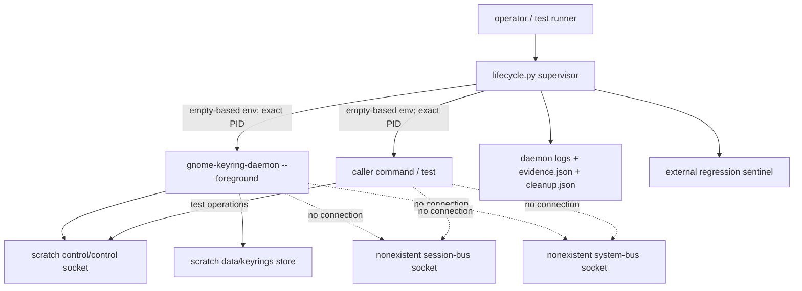
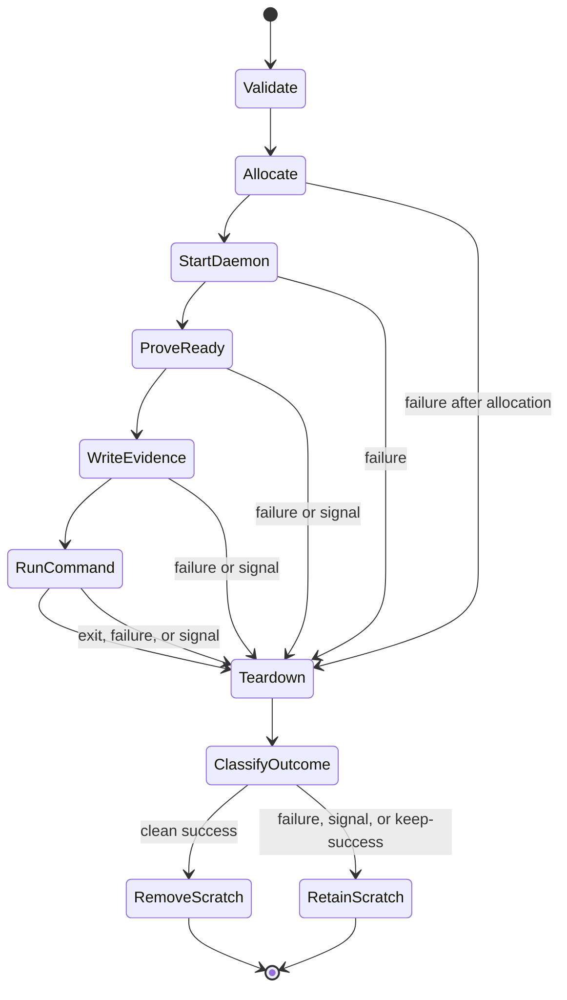
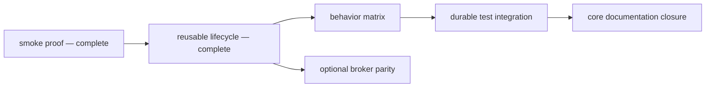

# GNOME Keyring integration harness

The `gmellon` harness runs commands against a fresh, manually launched
`gnome-keyring-daemon` while redirecting normal keyring, bus, and activation
discovery away from the user's desktop session. It exists to make the private
control protocol testable from an ordinary headless development shell. This is
a cooperative test boundary, not access control against the command itself.

The harness currently provides two executable entry points:

- [`dev/harness/smoke.py`](/dev/harness/smoke.py) proves one isolated
  fresh-UNLOCK and wrong-password-DENIED path.
- [`dev/harness/lifecycle.py`](/dev/harness/lifecycle.py) runs an arbitrary
  command with a fresh isolated daemon and a documented environment contract.

The control-only lifecycle is implemented and reviewed. Behavioral
characterization and durable Rust-test integration remain active work. Private
`dbus-broker` parity is optional and does not block control-socket tests.

## Guide map

Use this document as the durable operational and architectural guide. More
specialized sources have narrower authority:

| Need | Start here |
| --- | --- |
| Run or diagnose the current lifecycle | [Quick start](#quick-start), [Lifecycle interface](#lifecycle-interface), and [Troubleshooting](#troubleshooting) |
| Understand the security boundary | [Boundary and invariants](#boundary-and-invariants) and [Process topology](#process-topology) |
| Change lifecycle mechanics | [Lifecycle state model](#lifecycle-state-model), then [`dev/harness/lifecycle.py`](/dev/harness/lifecycle.py) and its [focused tests](/dev/harness/tests/test_lifecycle.py) |
| Add daemon behavior coverage | [Evolution guidance](#evolution-guidance) and the behavior scope in [`prompt.md`](/doc/harness/prompt.md) |
| Integrate with Rust or CI | [Durable test integration](#durable-test-integration) |
| Investigate Secret Service parity | [Optional broker parity](#optional-broker-parity) |
| Understand product motivation and protocol | The product [`README.md`](/README.md) |

The supported reusable surface is the executable command interface and the
exported environment documented below. Importable Python names in
`lifecycle.py` are implementation details used by focused tests, not a stable
library API.

## Quick start

Run the foundational smoke proof:

```sh
dev/harness/smoke.py
```

Run a command inside the reusable lifecycle:

```sh
dev/harness/lifecycle.py -- /usr/bin/env
```

See the complete executable contract without allocating a sandbox:

```sh
dev/harness/lifecycle.py --help
```

Inspect the selected private control socket from a command:

```sh
dev/harness/lifecycle.py -- \
  /usr/bin/python3 -c \
  'import os; print(os.environ["GMELL_HARNESS_CONTROL_SOCKET"])'
```

Successful runs remove their scratch data by default. Preserve a successful
run for inspection with `--keep-success`:

```sh
dev/harness/lifecycle.py --keep-success -- /usr/bin/true
```

Use absolute command paths where practical. The isolated command receives a
fixed `PATH=/usr/bin:/bin`, not the caller's executable search path.

## Boundary and invariants

Each invocation creates a short, unpredictable mode-0700 root beneath
`/home/rektide/tmp-opencode`. It launches one foreground daemon manually and
redirects the daemon's known writable paths into that root. Both session and
system D-Bus addresses point at explicitly nonexistent sockets under the same
root.

The resulting boundary is **configuration and session isolation**:

| Invariant | Mechanism and enforcement |
| --- | --- |
| Login keyring and PKCS#11 state select private storage | Private `HOME` and `XDG_DATA_HOME`; reported absolute daemon paths must resolve beneath scratch |
| Runtime and control endpoints are invocation-local | Private `XDG_RUNTIME_DIR`, unique control directory, and explicit `--control-directory` |
| Configuration, cache, state, and temporary paths are private | Dedicated XDG directories and `TMPDIR` beneath the unique root |
| Neither child can discover the user's buses through its environment | Both bus addresses name nonexistent scratch sockets; environments are built from empty maps |
| Host socket activation is not inherited | Empty-based environments omit `LISTEN_*`, `NOTIFY_SOCKET`, and D-Bus starter state |
| A command never starts against a merely present or stale path | One bounded readiness gate combines initialization EOF, daemon liveness, reported-path validation, socket type and ownership, and sentinel validation |
| Process ownership stays narrow | The supervisor signals and reaps its exact daemon and command PIDs; no name-based or host-wide cleanup |
| Failure remains inspectable | Nonzero command outcomes, handled signals, and harness failures retain allocated scratch state |
| Concurrent invocations do not share mutable harness state | Every root, store, socket, log, sentinel, and child PID is invocation-specific |
| Ownership is unambiguous | Nesting is rejected before allocation; detached descendants are outside the supported topology |
| Harness artifacts do not intentionally carry protocol secrets | The lifecycle records no command argv, command streams, frames, or explicit pass-through values |

The harness does **not** provide filesystem, network, syscall, user-namespace,
PID-namespace, or cgroup confinement. The command runs with the caller's UID,
capabilities, and working directory, so it can access anything the caller can.
The external sentinel detects one regression target; it does not prove that
arbitrary writes outside scratch are impossible.

Nor is the evidence tamper-resistant against the command. The command has the
caller's UID, knows its scratch root, and can modify files there. The sentinel
and JSON are regression and diagnosis aids for cooperative tests, not a
security boundary against hostile code.

Do not describe this layer as fully hermetic. A stronger sandbox could be
added deliberately later, but it is not implied by XDG and bus redirection.

## Process topology



The daemon and caller command are direct children of the supervisor. Each is
started in a separate session, while cleanup targets its exact PID rather than
using process names, `pkill`, or broad host process groups. The lifecycle does
not claim ownership of a command's intentionally detached descendants;
integration-test commands must not daemonize and escape supervision. A new
session separates terminal/process-group effects; it does not turn descendants
into supervisor-owned processes. The command remains responsible for stopping
and reaping any workers it creates.

## Lifecycle state model

The lifecycle is a narrow supervisor with one main transition sequence:



This ordering is part of the architecture:

- argument parsing rejects a missing command before scratch allocation, and
  the nesting guard rejects an already active harness before allocation;
- `evidence.json` is a **pre-command readiness snapshot**, written only after
  the full readiness gate succeeds;
- the command runs only while the original daemon remains live;
- `cleanup.json` is attempted after the bounded termination and reaping
  attempt, and is a teardown snapshot rather than a transactionally signed
  final result; and
- outcome classification happens only after cleanup, so cleanup failure can
  turn an otherwise successful command into harness failure.

A startup failure can therefore retain logs and `cleanup.json` without ever
having produced `evidence.json`. A test must not assume every retained root has
reached readiness.

## Readiness contract

The caller command starts only after the daemon satisfies all of these checks
under one shared eight-second deadline:

1. initialization stdout reaches EOF while being copied incrementally to its
   private log;
2. the daemon remains alive;
3. startup output reports the explicitly selected control directory;
4. every path reported by the daemon resolves beneath the scratch root;
5. `control/control` exists as a Unix socket owned by the effective UID; and
6. the external sentinel remains unchanged.

Socket existence alone is not readiness. GNOME Keyring closes initialization
stdout only after late initialization redirects that stream; the harness
combines this upstream signal with process and socket checks.

The baseline deliberately tolerates the daemon's diagnostic that its session
bus is unreachable. GNOME Keyring 48.0 initializes its control socket and
internal store before that non-fatal bus setup failure. Secret Service itself
is unavailable in this mode.

## Lifecycle interface

The executable accepts one command after `--`, optional repeated `--pass-env`
names, and optional successful-run retention:

```text
dev/harness/lifecycle.py [--keep-success] [--pass-env NAME] -- COMMAND [ARG...]
```

The command inherits the caller's current working directory and standard
streams. It does not inherit the caller's environment, has no harness-imposed
runtime deadline, and must not detach descendants. The harness's responsibility
is daemon readiness and owned-child lifecycle; the command's responsibility is
its assertions, its own worker lifecycle, and any timeout its test semantics
require.

The exported variables and exit classifications are the composition contract.
Console diagnostics and the current JSON fields are human/test evidence, not a
versioned interchange schema; promote any field needed by another maintained
tool explicitly, with documentation and acceptance coverage.

### Host assumptions

The current developer harness assumes POSIX process and signal semantics, Unix
sockets, a writable `/home/rektide/tmp-opencode`, and
`gnome-keyring-daemon` discoverable in `/usr/bin:/bin`. It is intentionally
host-specific today. Portable or packaged integration must make these
prerequisites explicit rather than silently weakening isolation or searching a
caller-controlled path.

## Command environment

The lifecycle constructs each child environment from an empty mapping. The
command receives the private baseline plus these harness variables:

| Variable | Meaning |
| --- | --- |
| `HOME` | private `<root>/home` |
| `XDG_RUNTIME_DIR` | private `<root>/runtime` |
| `XDG_DATA_HOME` | private `<root>/data` using production keyring path selection |
| `XDG_CONFIG_HOME` | private `<root>/config` |
| `XDG_CACHE_HOME` | private `<root>/cache` |
| `XDG_STATE_HOME` | private `<root>/state` |
| `TMPDIR` | private `<root>/tmp` |
| `DBUS_SESSION_BUS_ADDRESS` | unreachable `<root>/missing-session-bus` |
| `DBUS_SYSTEM_BUS_ADDRESS` | unreachable `<root>/missing-system-bus` |
| `PATH` | fixed `/usr/bin:/bin` |
| `LANG`, `LC_ALL` | fixed `C.UTF-8` |
| `GNOME_KEYRING_CONTROL` | private control directory |
| `GMELL_HARNESS_ACTIVE` | nesting marker, always `1` |
| `GMELL_HARNESS_ROOT` | unique scratch root |
| `GMELL_HARNESS_CONTROL_DIR` | private control directory |
| `GMELL_HARNESS_CONTROL_SOCKET` | exact control socket path |
| `GMELL_HARNESS_DAEMON_PID` | decimal daemon PID |
| `GMELL_HARNESS_DAEMON_STDOUT` | initialization stdout log |
| `GMELL_HARNESS_DAEMON_STDERR` | daemon diagnostics log |
| `GMELL_HARNESS_EVIDENCE` | readiness and isolation evidence |
| `GMELL_HARNESS_CLEANUP` | teardown evidence, written during cleanup |

The daemon receives only the private XDG/bus baseline; it does not receive the
`GMELL_HARNESS_*` command contract.

### Passing selected host values

Tests may explicitly copy a non-protected caller variable into the command:

```sh
TOKEN=opaque-test-token \
  dev/harness/lifecycle.py --pass-env TOKEN -- /path/to/test-command
```

Isolation, activation, desktop-session, keyring, and harness variables cannot
be overridden. Evidence records the passed variable's name but replaces its
value with an omission marker. The command remains responsible for not
printing sensitive values to its own stdout or stderr.

Value omission protects retained harness JSON; it does not make environment
variables a safe password channel. Generate disposable behavior-test secrets
inside the command or provide product input through an explicitly reviewed
stream. Never use argv or `--pass-env` for keyring passwords.

## Exit and retention semantics

| Event | Harness exit | Scratch retention |
| --- | ---: | --- |
| Command exits 0 | `0` | removed unless `--keep-success` |
| Command exits nonzero | exact command status | retained |
| Command dies from signal N | `128 + N` | retained |
| Harness receives HUP, INT, or TERM | `128 + N` after owned cleanup | retained |
| Harness startup, invariant, or cleanup failure | `125` | retained if allocated |
| Invalid lifecycle CLI usage | `2` | not allocated |

Command status 125 is numerically indistinguishable from harness failure 125.
The diagnostic prefix distinguishes `COMMAND FAILURE` from `HARNESS FAILURE`,
and retained JSON records the underlying child status.

The first HUP/INT/TERM is latched without throwing asynchronously. The latch
remains installed through teardown and evidence writing. Cleanup sends TERM to
all live exact direct children, waits under one shared deadline, sends KILL
only to survivors, waits again, and requires every child to be reaped; failure
to do so is a harness failure. A daemon that exits before harness-initiated
teardown is an error even when it exits zero.

Additional handled signals do not interrupt cleanup. SIGKILL remains
uncatchable. A sufficiently late signal after all children are reaped may
interrupt success-path scratch removal, but it cannot strand an owned child.
If a signal arrives after `cleanup.json` was written but before the latch is
restored, the process exit can reflect that signal while the earlier teardown
snapshot does not; use the process status as the final outcome and JSON as
evidence of the cleanup state at write time.

Unexpected Python programming exceptions are deliberately re-raised after the
same cleanup attempt so their traceback remains visible; they are not
normalized into the expected `HARNESS FAILURE` status contract.

## Parallelism and nesting

Independent invocations are parallel-safe: roots, keyring stores, socket
paths, logs, sentinels, and child PIDs are unique. There are no fixed writable
paths or shared keyring data.

Nesting is deliberately rejected. An invocation that inherits
`GMELL_HARNESS_ACTIVE` returns harness status 125 before allocating a new root
or launching a daemon. This prevents ambiguous ownership and control-socket
selection. Run independent harness instances from the outer test runner
instead.

## Artifacts and secret handling

After readiness, a retained root normally contains:

- `daemon.stdout.log` — startup environment output copied incrementally;
- `daemon.stderr.log` — daemon diagnostics, including expected dead-bus errors;
- `evidence.json` — the pre-command selected paths, sanitized command
  environment, and readiness snapshot;
- `cleanup.json` — command status, handled signal, and per-child teardown;
- private XDG directories and any keyring files created during the run.

Earlier failures may leave only the artifacts that had been opened or written
by that lifecycle state. `cleanup.json` is attempted whenever a root was
allocated, but a failure writing cleanup evidence is itself a harness failure.

The lifecycle does not record command argv, command output, control frames, or
explicitly passed environment values. Command streams remain attached to the
caller. Arbitrary daemon diagnostics cannot be generically secret-classified,
so test commands must never ask the daemon to log passwords or raw frames.

The smoke probe uses generated disposable values and scans retained daemon
logs and JSON for both values and complete request frames before reporting
success. The eventual product tests must use `gmellon`'s zeroizing secret
types; the lifecycle itself should remain unaware of password values.

## Using the lifecycle in tests

A test command should:

1. read selected paths from `GMELL_HARNESS_*` rather than rediscovering host
   state;
2. keep observations beneath `GMELL_HARNESS_ROOT` when they must survive a
   harness-level failure;
3. use the private `GNOME_KEYRING_CONTROL` directory or exact socket;
4. avoid detached descendants;
5. avoid GUI prompts and Secret Service calls in the control-only layer; and
6. never emit passwords or password-bearing frames.

The lifecycle currently starts one daemon per invocation. A restart-sensitive
behavior test cannot safely simulate a restart by killing the daemon from the
command: the supervisor correctly treats every pre-teardown daemon exit as a
harness failure, and the current interface has no seed-before-start point.
Preserve that invariant until restart is introduced as an explicit
supervisor-owned operation. Likewise, stopped-daemon fault tests must not
silently redefine unexpected daemon death as normal lifecycle behavior.

## Running harness checks

```sh
python3 -m py_compile \
  dev/harness/smoke.py \
  dev/harness/lifecycle.py \
  dev/harness/tests/test_lifecycle.py

python3 -m unittest -v dev/harness/tests/test_lifecycle.py
dev/harness/smoke.py

cargo fmt --all -- --check
cargo clippy --all-targets --all-features -- -D warnings
cargo nextest run
```

The focused lifecycle suite requires `gnome-keyring-daemon` and skips when it
is unavailable. Defining the durable opt-in and missing-tool policy for normal
Rust/CI workflows belongs to `gmell-harness-integration`; do not interpret an
unavailable-tool skip as real-daemon coverage.

## Troubleshooting

### `gnome-keyring-daemon was not found`

Install the system GNOME Keyring daemon in `/usr/bin` or `/bin`. The lifecycle
does not search a user-controlled `PATH`.

### `couldn't connect to dbus session bus`

This diagnostic is expected in the control-only harness. Both bus addresses
are intentionally dead. It is a failure only if the daemon exits or the
control socket never becomes ready.

### Readiness timeout

Inspect the printed retained root, especially `daemon.stdout.log` and
`daemon.stderr.log`. Readiness shares one absolute deadline; time spent waiting
for stdout EOF is not reset before socket validation.

### `nested lifecycle invocation is rejected`

The command inherited `GMELL_HARNESS_ACTIVE`. Run it directly under the
existing lifecycle, or start another independent harness from the outer test
runner rather than from inside the first command.

### Command unexpectedly exits 125

Look for `HARNESS FAILURE` versus `COMMAND FAILURE` and inspect
`cleanup.json`. Intentional daemon termination is a harness failure by design;
write any pre-termination observation beneath `GMELL_HARNESS_ROOT`.

### Retained directories accumulate

Failure retention is deliberate. The harness does not prune stale data or
processes automatically. Inspect and remove only roots you have identified as
safe; never use broad name-based process cleanup.

## Work graph and scope



The core chain proceeds through behavior, integration, and documentation.
Broker parity branches independently after lifecycle and must not gate
`gmellon unlock` or any direct control-protocol test. Only the broker branch
may make non-prompting Secret Service observations.

The harness deliberately does not implement `gmellon unlock` or `change`, use
the real session bus temporarily, launch a GUI prompter, rename real keyrings,
clean unrelated processes/data, or make broker mechanics Rust product
dependencies.

## Contract, implementation, and evidence

These sources answer different questions and should not be flattened into one
kind of truth:

| Source | Role |
| --- | --- |
| This guide and `lifecycle.py --help` | Current operator-facing lifecycle contract |
| [`dev/harness/lifecycle.py`](/dev/harness/lifecycle.py) | Executable mechanics; the final authority on what the current revision actually does |
| [`dev/harness/tests/test_lifecycle.py`](/dev/harness/tests/test_lifecycle.py) | Executable acceptance coverage for lifecycle invariants and races |
| [`smoke0.gpt6a.md`](/doc/harness/smoke0.gpt6a.md) and [`lifecycle0.gpt6a.md`](/doc/harness/lifecycle0.gpt6a.md) | Version-scoped observations from completed runs; evidence, not timeless daemon promises |
| [`prompt.md`](/doc/harness/prompt.md) | Epic constraints, ticket boundaries, upstream findings, and planned acceptance; not proof that future behavior exists |
| Product [`README.md`](/README.md) | Product and wire-protocol specification; not the harness lifecycle contract |
| Beads graph | Review and work status; not runtime behavior |

When mechanics change, update implementation, focused tests, `--help`, and
this guide together. Record new installed-daemon behavior in a new or clearly
revised evidence document with the binary/platform context. A source reading
can motivate a test but must not be promoted to an installed-binary behavior
claim without observation.

## Evolution guidance

The current deep interface is deliberately small: launch a fresh isolated
daemon, prove readiness, run one command under a strict environment contract,
and classify the result after owned teardown. Extend orchestration behind that
interface rather than teaching product code about daemon startup, scratch
layout, broker activation, or harness JSON.

### Behavior characterization

- Keep wire operations and assertions in a disposable probe or reviewed Rust
  client; keep process, path, readiness, and cleanup ownership in the harness.
- Record results as installed-daemon evidence, including version and platform.
  Do not turn one observation into an unqualified upstream guarantee.
- Preserve the unexpected-daemon-exit invariant. Restart persistence needs a
  first-class supervisor transition that stops and reaps the owned daemon,
  preserves only the intended private store, starts a new owned daemon, and
  repeats readiness before resuming assertions. An alternative seed-before-
  startup interface would also need an explicit, validated input contract.
- Model stopped or unresponsive daemon cases through a deliberate fault seam
  or lower-level transport fixture. Do not make arbitrary daemon death a
  successful lifecycle outcome merely to obtain product error coverage.
- Keep control-only behavior free of Secret Service calls.

These are extension constraints, not claims that restart, seeding, or fault
injection exists today.

### Durable test integration

- Invoke the executable lifecycle and consume `GMELL_HARNESS_*`; do not import
  its Python internals or duplicate environment construction in Rust tests.
- Keep pure codec and fake-socket transport tests independent of the installed
  daemon. Real-daemon tests are a distinct integration capability.
- Define an explicit opt-in and prerequisite policy: a requested real-daemon
  run must fail when the daemon is unavailable, while ordinary workflows must
  make omitted coverage visible rather than implying it ran.
- Preserve per-invocation roots so integration cases remain parallel-safe.
  Add serialization only for a demonstrated external shared resource.
- Keep secrets generated and consumed within the narrowest test scope; harness
  artifacts should contain operations, paths, statuses, and lengths at most,
  never password-bearing frames.

The current Python suite's missing-tool skip is focused lifecycle test policy,
not yet the durable Rust/CI integration policy.

### Optional broker parity

Broker parity is a sibling topology profile, not an upgrade that should make
the baseline depend on D-Bus. It may add a supervisor-owned listener, broker,
and manually launched daemon, but it must preserve unique scratch state,
empty-based child environments, bounded readiness, exact ownership, retained
failure evidence, and no activation of host services.

Any broker interface should identify its capability explicitly rather than
changing the meaning of the control-only variables. Broker readiness must add
a responsive private bus and proof that the intended daemon owns the expected
names; control-socket readiness remains independently meaningful. Keep the
known `dbus-broker-launch` systemd/controller and journal dependencies visible:
if they prevent the requested isolation on a host, report that limitation
rather than silently using the real bus or substituting `dbus-daemon` as the
delivered topology. Broker mechanics must remain outside Rust product
dependencies and may not gate direct control-protocol tests.

## Source and evidence map

- [`/doc/harness/prompt.md`](/doc/harness/prompt.md) — epic safety invariants,
  upstream facts, ticket boundaries, and the work graph; planned acceptance,
  not completion evidence.
- [`/doc/harness/smoke0.gpt6a.md`](/doc/harness/smoke0.gpt6a.md) — installed
  daemon evidence for the first UNLOCK/denial path and exact-PID cleanup.
- [`/doc/harness/lifecycle0.gpt6a.md`](/doc/harness/lifecycle0.gpt6a.md) —
  detailed lifecycle, signal-race, environment, retention, and test evidence.
- [`/README.md`](/README.md) — product contract, private wire protocol, and the
  unlock-or-create hazard that motivates real-daemon testing.
- [`dev/harness/tests/test_lifecycle.py`](/dev/harness/tests/test_lifecycle.py)
  — executable lifecycle acceptance coverage.

Check `bd show gmell-harness` and the ready Beads frontier before extending the
harness. Behavioral claims belong in evidence only after they are observed
against the installed daemon.
