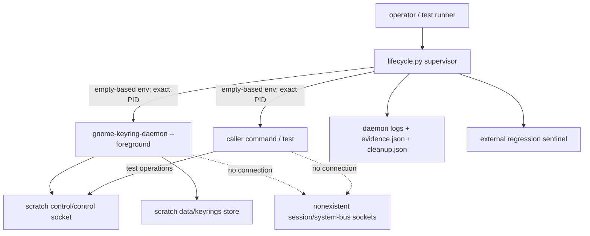
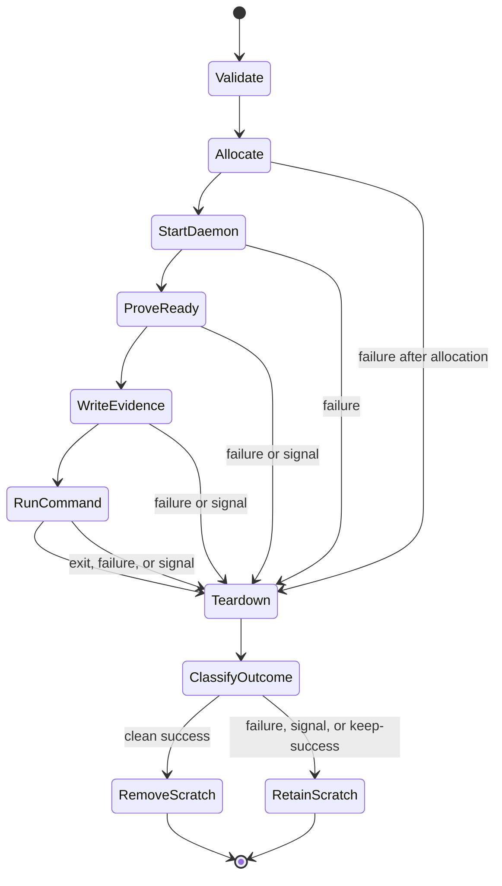

# GNOME Keyring integration harness

The `gmellon` harness makes the private control protocol testable from an
ordinary headless development shell: it runs commands against a fresh,
manually launched `gnome-keyring-daemon` while redirecting normal keyring,
bus, and activation discovery away from the user's desktop session. This is
a cooperative test boundary, not access control against the command itself.

The harness currently provides four executable entry points:

- [`dev/harness/smoke.py`](/dev/harness/smoke.py) proves one isolated
  fresh-UNLOCK and wrong-password-DENIED path.
- [`dev/harness/lifecycle.py`](/dev/harness/lifecycle.py) runs an arbitrary
  command with a fresh isolated daemon and a documented environment contract.
- [`dev/harness/behavior.py`](/dev/harness/behavior.py) characterizes UNLOCK,
  CHANGE, restart persistence, empty passwords, and explicit transport faults
  against the installed daemon without making Secret Service calls.
- [`dev/harness/check`](/dev/harness/check) is the maintained explicit check
  entry point for Rust real-daemon tests and the broader Python checks.

The control-only lifecycle and installed behavior characterization are
reviewed. Durable Rust-test integration is implemented and remains in review.
Private `dbus-broker` parity is optional and does not block control-socket
tests.

## Guide map

Use this document as the durable operational and architectural guide. More
specialized sources have narrower authority — see
[Contract, implementation, and evidence](#contract-implementation-and-evidence)
for how that authority divides:

| Need | Start here |
| --- | --- |
| Run or diagnose the current lifecycle | [Quick start](#quick-start), [Lifecycle interface](#lifecycle-interface), and [Troubleshooting](#troubleshooting) |
| Understand the security boundary | [Boundary and invariants](#boundary-and-invariants) and [Process topology](#process-topology) |
| Change lifecycle mechanics | [Lifecycle state model](#lifecycle-state-model), then [`dev/harness/lifecycle.py`](/dev/harness/lifecycle.py) and its [focused tests](/dev/harness/tests/test_lifecycle.py) |
| Run or inspect daemon behavior coverage | [Quick start](#quick-start), [`behavior0.gpt6a.md`](/doc/harness/behavior0.gpt6a.md), and [Evolution guidance](#evolution-guidance) |
| Integrate with Rust or CI | [Durable test integration](#durable-test-integration) and [`integration0.gpt6a.md`](/doc/harness/integration0.gpt6a.md) |
| Investigate Secret Service parity | [Optional broker parity](#optional-broker-parity) |

The supported reusable surface is the executable command interface and the
exported environment documented below. Importable Python names in
`lifecycle.py` are implementation details used by focused tests, not a stable
library API.

## Quick start

Run the foundational smoke proof:

```sh
dev/harness/smoke.py
```

Run the complete installed-daemon behavior matrix:

```sh
dev/harness/behavior.py
```

Add `--keep-success` to retain its four scenario roots and their redacted
`behavior.json` observations.

Run a command inside the reusable lifecycle:

```sh
dev/harness/lifecycle.py -- /usr/bin/env
```

See the complete executable contract without allocating a sandbox:

```sh
dev/harness/lifecycle.py --help
```

Run the maintained Rust transport against two independent real daemons using
nextest:

```sh
dev/harness/check rust-nextest
```

Use `dev/harness/check rust-cargo` for normal Cargo test conventions. Run all
external-tool harness checks, including the Python lifecycle suite, installed
behavior matrix, and smoke proof, with:

```sh
dev/harness/check all
```

Inspect the selected private control socket from a command:

```sh
dev/harness/lifecycle.py -- \
  /usr/bin/python3 -c \
  'import os; print(os.environ["GMELL_HARNESS_CONTROL_SOCKET"])'
```

Successful runs remove their scratch data by default; preserve a successful
run for inspection with `--keep-success`:

```sh
dev/harness/lifecycle.py --keep-success -- /usr/bin/true
```

Use absolute command paths where practical: the isolated command receives a
fixed `PATH=/usr/bin:/bin`, not the caller's executable search path.

## Lifecycle interface

The executable accepts one command after `--`, optional repeated `--pass-env`
names, and optional successful-run retention:

```text
dev/harness/lifecycle.py [--keep-success] [--pass-env NAME] -- COMMAND [ARG...]
```

The command inherits the caller's current working directory and standard
streams. It does not inherit the caller's environment, has no harness-imposed
runtime deadline, and must not detach descendants. The harness owns daemon
readiness and the lifecycle of its exact children; the command owns its
assertions, its workers, and any timeout its test semantics require.

The exported variables and exit classifications below are the composition
contract. Console diagnostics and the current JSON fields are human/test
evidence, not a versioned interchange schema; promote any field needed by
another maintained tool explicitly, with documentation and acceptance
coverage.

### Host assumptions

The current developer harness assumes Linux/POSIX process and signal semantics,
Unix sockets and peer credentials, readable `/dev/urandom`, a writable
`/home/rektide/tmp-opencode`, Python 3 on `PATH`, and
`gnome-keyring-daemon` discoverable in `/usr/bin:/bin`. Rust entry points also
require Cargo, and the nextest modes require `cargo-nextest`. It is
intentionally host-specific today: portable or packaged integration must make
these prerequisites explicit rather than silently weakening isolation or
searching a caller-controlled daemon path.

## Command environment

Each child environment is constructed from an empty mapping. The command
receives the private baseline plus these harness variables:

| Variable | Meaning |
| --- | --- |
| `HOME` | private `<root>/home` |
| `XDG_RUNTIME_DIR` | private `<root>/runtime` |
| `XDG_DATA_HOME` | private `<root>/data` using production keyring path selection |
| `XDG_CONFIG_HOME` | private `<root>/config` |
| `XDG_CACHE_HOME` | private `<root>/cache` |
| `XDG_STATE_HOME` | private `<root>/state` |
| `TMPDIR` | private `<root>/tmp` |
| `DBUS_SESSION_BUS_ADDRESS` | unreachable `<root>/missing-session-bus` |
| `DBUS_SYSTEM_BUS_ADDRESS` | unreachable `<root>/missing-system-bus` |
| `PATH` | fixed `/usr/bin:/bin` |
| `LANG`, `LC_ALL` | fixed `C.UTF-8` |
| `GNOME_KEYRING_CONTROL` | private control directory |
| `GMELL_HARNESS_ACTIVE` | nesting marker, always `1` |
| `GMELL_HARNESS_ROOT` | unique scratch root |
| `GMELL_HARNESS_CONTROL_DIR` | private control directory |
| `GMELL_HARNESS_CONTROL_SOCKET` | exact control socket path |
| `GMELL_HARNESS_DAEMON_PID` | decimal daemon PID |
| `GMELL_HARNESS_DAEMON_STDOUT` | initialization stdout log |
| `GMELL_HARNESS_DAEMON_STDERR` | daemon diagnostics log |
| `GMELL_HARNESS_EVIDENCE` | readiness and isolation evidence |
| `GMELL_HARNESS_CLEANUP` | teardown evidence, written during cleanup |

The daemon receives only the private XDG/bus baseline; it does not receive
the `GMELL_HARNESS_*` command contract.

### Passing selected host values

Tests may explicitly copy a non-protected caller variable into the command:

```sh
TOKEN=opaque-test-token \
  dev/harness/lifecycle.py --pass-env TOKEN -- /path/to/test-command
```

Isolation, activation, desktop-session, keyring, and harness variables cannot
be overridden. Evidence records the passed variable's name but replaces its
value with an omission marker; the command remains responsible for not
printing sensitive values to its own stdout or stderr.

Value omission protects retained harness JSON; it does not make environment
variables a safe password channel. Generate disposable behavior-test secrets
inside the command or provide product input through an explicitly reviewed
stream, and never use argv or `--pass-env` for keyring passwords.

## Readiness contract

The command starts only after the daemon satisfies all of these checks under
one shared eight-second deadline:

1. initialization stdout reaches EOF while being copied incrementally to its
   private log;
2. the daemon remains alive;
3. startup output reports the explicitly selected control directory;
4. every path reported by the daemon resolves beneath the scratch root;
5. `control/control` exists as a Unix socket owned by the effective UID; and
6. the external sentinel — a regression tripwire kept outside the scratch
   root — remains unchanged.

Socket existence alone is not readiness: GNOME Keyring closes initialization
stdout only after late initialization redirects that stream, and the harness
combines that upstream signal with process and socket checks. The baseline
deliberately tolerates the daemon's unreachable-session-bus diagnostic —
GNOME Keyring 48.0 initializes its control socket and internal store before
that non-fatal failure — but Secret Service itself is unavailable in this
mode.

## Exit and retention semantics

| Event | Harness exit | Scratch retention |
| --- | ---: | --- |
| Command exits 0 | `0` | removed unless `--keep-success` |
| Command exits nonzero | exact command status | retained |
| Command dies from signal N | `128 + N` | retained |
| Harness receives HUP, INT, or TERM | `128 + N` after owned cleanup | retained |
| Harness startup, invariant, or cleanup failure | `125` | retained if allocated |
| Invalid lifecycle CLI usage | `2` | not allocated |

Command status 125 is numerically indistinguishable from harness failure 125.
The diagnostic prefix distinguishes `COMMAND FAILURE` from `HARNESS FAILURE`,
and retained JSON records the underlying child status.

The first HUP/INT/TERM is latched without throwing asynchronously, and the
latch remains installed through teardown and evidence writing. Cleanup sends
TERM to all live exact direct children, waits under one shared deadline,
sends KILL only to survivors, waits again, and requires every child to be
reaped; failure to do so is a harness failure. A daemon that exits before
harness-initiated teardown is an error even when it exits zero.

Additional handled signals do not interrupt cleanup, and SIGKILL remains
uncatchable. A sufficiently late signal after all children are reaped may
interrupt success-path scratch removal, but it cannot strand an owned child.
If a signal arrives after `cleanup.json` was written but before the latch is
restored, the process exit can reflect that signal while the earlier teardown
snapshot does not; the process status is the final outcome, and the JSON is
evidence of the cleanup state at write time.

Unexpected Python programming exceptions are deliberately re-raised after the
same cleanup attempt so their traceback remains visible; they are not
normalized into the expected `HARNESS FAILURE` status contract.

## Parallelism and nesting

Independent invocations are parallel-safe: roots, keyring stores, socket
paths, logs, sentinels, and child PIDs are unique, with no fixed writable
paths or shared keyring data. Nesting is deliberately rejected — an
invocation that inherits `GMELL_HARNESS_ACTIVE` returns harness status 125
before allocating a new root or launching a daemon, preventing ambiguous
ownership and control-socket selection. Run independent harness instances
from the outer test runner instead.

## Boundary and invariants

Each invocation creates a short, unpredictable mode-0700 root beneath
`/home/rektide/tmp-opencode`, launches one foreground daemon manually with
its known writable paths redirected into that root, and points both session
and system D-Bus addresses at explicitly nonexistent sockets under the same
root. The resulting boundary is **configuration and session isolation**:

| Invariant | Mechanism and enforcement |
| --- | --- |
| Login keyring, PKCS#11, and all daemon-selected storage stays private | Private `HOME`, `XDG_DATA_HOME`, dedicated config/cache/state directories, and `TMPDIR` beneath the unique root; reported absolute daemon paths must resolve beneath scratch |
| Runtime and control endpoints are invocation-local | Private `XDG_RUNTIME_DIR`, unique control directory, and explicit `--control-directory` |
| Neither child can discover the user's buses through its environment | Both bus addresses name nonexistent scratch sockets; environments are built from empty maps |
| Host socket activation is not inherited | Empty-based environments omit `LISTEN_*`, `NOTIFY_SOCKET`, and D-Bus starter state |
| A command never starts against a merely present or stale path | One bounded readiness gate combines all checks in the [readiness contract](#readiness-contract) |
| Process ownership stays narrow | The supervisor signals and reaps its exact daemon and command PIDs; no name-based or host-wide cleanup |
| Failure remains inspectable | Nonzero command outcomes, handled signals, and harness failures retain allocated scratch state |
| Concurrent invocations do not share mutable harness state | Every root, store, socket, log, sentinel, and child PID is invocation-specific |
| Ownership is unambiguous | Nesting is rejected before allocation; detached descendants are outside the supported topology |
| Harness artifacts do not intentionally carry protocol secrets | The lifecycle records no command argv, command streams, frames, or explicit pass-through values |

The harness does **not** provide filesystem, network, syscall,
user-namespace, PID-namespace, or cgroup confinement: the command runs with
the caller's UID, capabilities, and working directory, so it can access
anything the caller can. The external sentinel detects one regression
target; it does not prove that arbitrary writes outside scratch are
impossible.

Nor is the evidence tamper-resistant against the command. The command has
the caller's UID, knows its scratch root, and can modify files there. The
sentinel and JSON are regression and diagnosis aids for cooperative tests,
not a security boundary against hostile code.

Do not describe this layer as fully hermetic. A stronger sandbox could be
added deliberately later, but it is not implied by XDG and bus redirection.

## Process topology



The daemon and command are direct children of the supervisor, each started in
a separate session, and cleanup targets exact PIDs rather than process names,
`pkill`, or broad host process groups. A new session separates terminal and
process-group effects; it does not make descendants supervisor-owned. The
lifecycle does not claim a command's intentionally detached descendants:
integration-test commands must not daemonize and escape supervision, and the
command stops and reaps any workers it creates.

## Lifecycle state model

The lifecycle is a narrow supervisor with one main transition sequence:



This ordering is part of the architecture:

- argument parsing rejects a missing command before scratch allocation, and
  the nesting guard rejects an already active harness before allocation;
- `evidence.json` is a **pre-command readiness snapshot**, written only after
  the full readiness gate succeeds;
- the command runs only while the original daemon remains live;
- `cleanup.json` is a teardown snapshot attempted after bounded termination
  and reaping, not a transactionally signed final result; and
- outcome classification happens only after cleanup, so cleanup failure can
  turn an otherwise successful command into a harness failure.

A startup failure can therefore retain logs and `cleanup.json` without ever
having produced `evidence.json`; a test must not assume every retained root
has reached readiness.

## Artifacts and secret handling

After readiness, a retained root normally contains:

- `daemon.stdout.log` — startup output, copied incrementally;
- `daemon.stderr.log` — daemon diagnostics, including expected dead-bus
  errors;
- `evidence.json` — pre-command selected paths, sanitized command
  environment, and readiness snapshot;
- `cleanup.json` — command status, handled signal, and per-child teardown;
- private XDG directories and any keyring files created during the run.

Earlier failures may leave only the artifacts opened or written by that
lifecycle state. `cleanup.json` is attempted whenever a root was allocated,
and a failure writing it is itself a harness failure.

The lifecycle records no command argv, command output, control frames, or
explicitly passed environment values, and command streams remain attached to
the caller. Arbitrary daemon diagnostics cannot be generically
secret-classified, so test commands must never ask the daemon to log
passwords or raw frames. The smoke probe uses generated disposable values
and scans retained logs and JSON for both values and complete request frames
before reporting success. The behavior probe scans every regular file in each
retained scenario root. Eventual product tests must use `gmellon`'s zeroizing
secret types, and the lifecycle itself remains unaware of password values.

## Using the lifecycle in tests

A test command should:

1. read selected paths from `GMELL_HARNESS_*` rather than rediscovering host
   state;
2. keep observations beneath `GMELL_HARNESS_ROOT` when they must survive a
   harness-level failure;
3. use the private `GNOME_KEYRING_CONTROL` directory or exact socket;
4. avoid detached descendants;
5. avoid GUI prompts and Secret Service calls in the control-only layer; and
6. never emit passwords or password-bearing frames.

The lifecycle command interface still starts one daemon per invocation. A
command must not simulate a restart by killing it: every pre-teardown daemon
exit remains a harness failure. Restart and fault characterization belongs to
the sibling [`behavior.py`](/dev/harness/behavior.py) supervisor, which owns
explicit stop/restart and SIGSTOP/SIGCONT transitions while reusing the
lifecycle's internal readiness and exact-PID stop checks. Those Python names
are co-located implementation seams, not a public import contract.

## Running harness checks

### Ordinary Rust workflow

The real-daemon tests are normal Rust integration tests marked `#[ignore]`.
Ordinary workflows stay pure and make the omission visible:

```sh
cargo test
cargo nextest run
```

Cargo reports two tests as `ignored`; nextest reports two as `skipped`. The
pure codec unit tests and fake Unix-socket transport tests remain in the
ordinary run and never invoke Python or a system daemon. Do not select only the
ignored test binary without `--run-ignored`: nextest correctly returns its
"no tests to run" status in that narrowed case.

### Explicit real-daemon workflow

Use either maintained wrapper mode from the repository root:

```sh
dev/harness/check rust-nextest
dev/harness/check rust-cargo
```

The corresponding direct conventional commands are:

```sh
cargo nextest run --test real_daemon --run-ignored ignored-only
cargo test --test real_daemon -- --ignored
```

Both tests first validate Linux support, an executable lifecycle, `python3`, a
runnable system `gnome-keyring-daemon`, and readable `/dev/urandom`. The
wrapper additionally validates Cargo and cargo-nextest where applicable. Any
missing or unusable prerequisite is a hard failure with installation or repair
guidance: wrapper preflight exits 125, while a direct Rust command fails its
requested test. Neither path converts a requested integration run into an
ignore or skip.

Each outer Rust test invokes the executable
[`lifecycle.py`](/dev/harness/lifecycle.py) command and re-runs only its own
test binary as the lifecycle command. It does not import Python or reconstruct
the daemon environment. The inner test consumes `GMELL_HARNESS_*` and uses the
public `gmellon::control::SyncClient` to cover:

- fresh UNLOCK, login-file creation, repeated correct UNLOCK, and wrong
  password DENIED; and
- fixture UNLOCK, CHANGE A-to-B, B accepted, and former A denied.

These are transport/product-relevant paths available before the unlock/change
CLI exists. Restart persistence and explicit stopped/unresponsive transitions
remain in `behavior.py`, whose supervisor coherently owns those transitions.

Instances need no test-runner serialization: each ignored test gets a unique
lifecycle root, daemon, control socket, store, and sentinel. Add
`--keep-success` to the wrapper before the mode to retain successful Rust
artifacts, or set `GMELL_HARNESS_KEEP_SUCCESS=1` for a direct Cargo/nextest
command. The retained `rust-integration.txt` contains operation-path labels,
the Rust transport name, secret count, and a post-scan marker only; generated
passwords are zeroized on drop and scanned against every regular file in the
root before success. The same scan runs before an operation assertion panic is
re-thrown, so lifecycle-retained failure artifacts are checked while the
generated values remain available. `--keep-success` also retains the behavior
and smoke roots when used with `python` or `all`.

### Broader Python workflow

The maintained explicit command is:

```sh
dev/harness/check python
```

It compiles all harness Python, runs the focused lifecycle/behavior tests, then
runs the installed behavior matrix and smoke proof. `dev/harness/check all`
runs the nextest real-daemon path followed by those checks. The wrapper
preflights external tools before calling existing executables; it does not
duplicate lifecycle orchestration. The focused Python tests retain their
convenient unittest skip annotations for direct development invocation, but an
explicit `dev/harness/check` mode fails before unittest if the daemon is
missing. A skip from direct unittest is not evidence of real-daemon coverage.

### Complete static and Rust checks

```sh
sh -n dev/harness/check
python3 -m py_compile \
  dev/harness/smoke.py \
  dev/harness/behavior.py \
  dev/harness/lifecycle.py \
  dev/harness/tests/test_behavior.py \
  dev/harness/tests/test_lifecycle.py

python3 -m unittest -v \
  dev/harness/tests/test_behavior.py \
  dev/harness/tests/test_lifecycle.py
dev/harness/behavior.py
dev/harness/smoke.py

cargo fmt --all -- --check
cargo clippy --all-targets --all-features -- -D warnings
cargo nextest run
```

There is currently no tracked CI configuration in this repository. Operator
policy is therefore explicit rather than presented as an existing CI job:

1. ordinary development runs full `cargo nextest run`, whose summary must show
   the two omitted real-daemon tests as skipped;
2. a provisioned Linux integration environment runs `dev/harness/check all`;
3. missing prerequisites in that explicitly provisioned run are setup
   failures, never allowed skips; and
4. future CI should preserve these as distinct jobs/capabilities rather than
   installing or launching GNOME Keyring in every pure-test job.

## Troubleshooting

### `gnome-keyring-daemon was not found`

Install the system GNOME Keyring daemon in `/usr/bin` or `/bin`. The
lifecycle does not search a user-controlled `PATH`.

### `couldn't connect to dbus session bus`

This diagnostic is expected in the control-only harness: both bus addresses
are intentionally dead. It is a failure only if the daemon exits or the
control socket never becomes ready.

### Readiness timeout

Inspect the printed retained root, especially `daemon.stdout.log` and
`daemon.stderr.log`. Readiness shares one absolute deadline; time spent
waiting for stdout EOF is not reset before socket validation.

### `nested lifecycle invocation is rejected`

The command inherited `GMELL_HARNESS_ACTIVE`. Run the command directly under
the existing lifecycle, or start another independent harness from the outer
test runner rather than from inside the first command.

### Command unexpectedly exits 125

Look for `HARNESS FAILURE` versus `COMMAND FAILURE` and inspect
`cleanup.json`. Daemon termination initiated by a lifecycle command is a
harness failure by design; explicit restart and fault transitions belong to
`behavior.py`.

### Retained directories accumulate

Failure retention is deliberate, and the harness does not prune stale data
or processes automatically. Inspect and remove only roots you have identified
as safe; never use broad name-based process cleanup.

## Contract, implementation, and evidence

These sources answer different questions and should not be flattened into
one kind of truth:

| Source | Role |
| --- | --- |
| This guide and `lifecycle.py --help` | Current operator-facing lifecycle contract |
| [`dev/harness/lifecycle.py`](/dev/harness/lifecycle.py) | Executable mechanics; the final authority on what the current revision actually does |
| [`dev/harness/check`](/dev/harness/check) | Maintained explicit prerequisite and check composition; delegates lifecycle/process orchestration |
| [`tests/harness/real_daemon.rs`](/tests/harness/real_daemon.rs) | Ignored Rust integration boundary and real `SyncClient` assertions |
| [`dev/harness/tests/test_lifecycle.py`](/dev/harness/tests/test_lifecycle.py) | Executable acceptance coverage for lifecycle invariants and races |
| [`dev/harness/behavior.py`](/dev/harness/behavior.py) and its [black-box test](/dev/harness/tests/test_behavior.py) | Reproducible installed-daemon control matrix plus explicit behavior-owned restart/fault transitions |
| [`smoke0.gpt6a.md`](/doc/harness/smoke0.gpt6a.md) | Version-scoped installed-daemon evidence for the first UNLOCK/denial path and exact-PID cleanup; evidence, not timeless daemon promises |
| [`lifecycle0.gpt6a.md`](/doc/harness/lifecycle0.gpt6a.md) | Version-scoped lifecycle, signal-race, environment, retention, and test evidence; evidence, not timeless daemon promises |
| [`behavior0.gpt6a.md`](/doc/harness/behavior0.gpt6a.md) | Version-scoped UNLOCK, CHANGE, restart, empty-password, stopped, and unresponsive observations; evidence, not timeless daemon promises |
| [`integration0.gpt6a.md`](/doc/harness/integration0.gpt6a.md) | Version-scoped durable entry-point, skip/fail, Rust transport, parallel-isolation, and retained-artifact evidence |
| [`prompt.md`](/doc/harness/prompt.md) | Epic safety invariants, upstream facts, ticket boundaries, and the work graph; planned acceptance, not completion evidence |
| Product [`README.md`](/README.md) | Product contract, private wire protocol, and the unlock-or-create hazard that motivates real-daemon testing; not the harness lifecycle contract |
| Beads graph | Review and work status; not runtime behavior |

When mechanics change, update implementation, focused tests, `--help`, and
this guide together. Record new installed-daemon behavior in a new or clearly
revised evidence document with binary and platform context; a source reading
can motivate a test but must not be promoted to an installed-binary behavior
claim without observation. Before extending the harness, check
`bd show gmell-harness` and the ready Beads frontier — behavioral claims
belong in evidence only after observation against the installed daemon.

## Evolution guidance

The smoke proof, reusable lifecycle, and control-protocol behavior matrix are
complete. Durable test integration is implemented pending review; after
acceptance, the remaining core ticket is documentation closure. The harness
deliberately does not implement
`gmellon unlock` or `change`, use the real session bus temporarily, launch a
GUI prompter, rename real keyrings, clean unrelated processes or data, or
make broker mechanics Rust product dependencies. Optional broker parity
branches independently after lifecycle — it must not gate `gmellon unlock`
or any direct control-protocol test, and only that branch may make
non-prompting Secret Service observations.

The current deep interface is deliberately small: launch a fresh isolated
daemon, prove readiness, run one command under a strict environment
contract, and classify the result after owned teardown. Extend orchestration
behind that interface rather than teaching product code about daemon startup,
scratch layout, broker activation, or harness JSON.

### Behavior characterization

- Keep wire operations and assertions in a disposable probe or reviewed Rust
  client; keep process, path, readiness, and cleanup ownership in the
  harness.
- Record results as installed-daemon evidence, including version and
  platform. Do not turn one observation into an unqualified upstream
  guarantee.
- Preserve the unexpected-daemon-exit invariant. The implemented behavior
  supervisor stops and reaps the exact owned daemon, preserves its private
  store in place, starts a new generation, and repeats readiness. The general
  lifecycle contract does not expose root reuse or seed copying.
- Model stopped and unresponsive cases only through the implemented explicit
  supervisor stop and SIGSTOP/SIGCONT fault transitions. Arbitrary daemon death
  remains a lifecycle and behavior failure.
- Keep control-only behavior free of Secret Service calls.

Installed 48.0 results and limitations are recorded in
[`behavior0.gpt6a.md`](/doc/harness/behavior0.gpt6a.md); they must not be
generalized into timeless upstream guarantees.

### Durable test integration

- Keep the ignored Rust tests as thin lifecycle-command clients: consume
  `GMELL_HARNESS_*`, use public product transport, and leave daemon mechanics
  behind the executable Python contract.
- Add future product cases to [`tests/harness/real_daemon.rs`](/tests/harness/real_daemon.rs)
  when one fresh daemon is coherent. Put explicit restarts and fault injection
  behind a supervisor-owned executable rather than killing lifecycle children
  from Rust.
- Preserve the ordinary ignored/skipped signal and explicit hard-failure
  prerequisite contract. Never add tool-detection that returns early from an
  explicitly selected test.
- Preserve one unique lifecycle per test. Serialize only after demonstrating
  a genuinely shared external resource.
- Keep generated secrets inside the inner Rust process, zeroizing their owned
  buffers and scanning retained regular artifacts without printing values or
  password-bearing frames.

### Optional broker parity

Broker parity is a sibling topology profile, not an upgrade that should make
the baseline depend on D-Bus. It may add a supervisor-owned listener, broker,
and manually launched daemon, but it must preserve unique scratch state,
empty-based child environments, bounded readiness, exact ownership, retained
failure evidence, and no activation of host services.

Any broker interface should identify its capability explicitly rather than
changing the meaning of the control-only variables. Broker readiness must
add a responsive private bus and proof that the intended daemon owns the
expected names, while control-socket readiness remains independently
meaningful. Keep the known `dbus-broker-launch` systemd/controller and
journal dependencies visible: if they prevent the requested isolation on a
host, report that limitation rather than silently using the real bus or
substituting `dbus-daemon` as the delivered topology. Broker mechanics stay
outside Rust product dependencies and may not gate direct control-protocol
tests.
