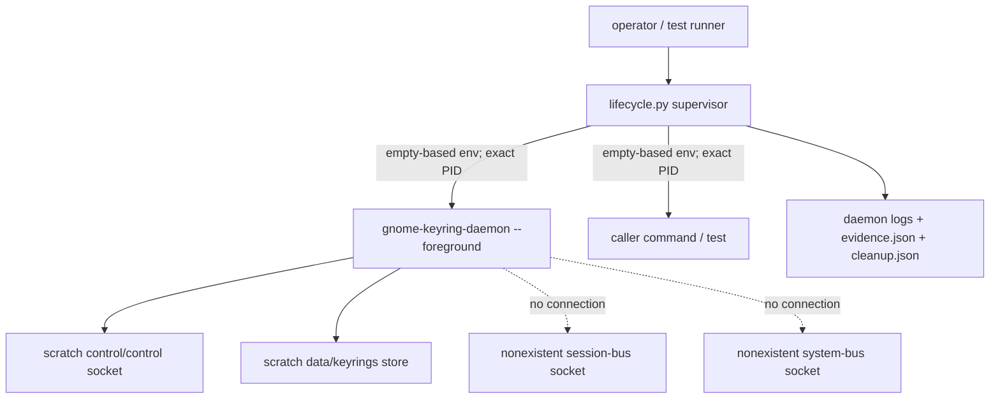
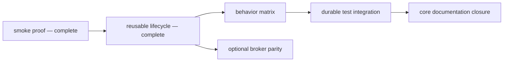

# GNOME Keyring integration harness

The `gmellon` harness runs commands against a fresh, manually launched
`gnome-keyring-daemon` without exposing the user's real keyring, desktop
session bus, system bus, or socket-activated daemon. It exists to make the
private control protocol testable from an ordinary headless development shell.

The harness currently provides two executable entry points:

- [`dev/harness/smoke.py`](/dev/harness/smoke.py) proves one isolated
  fresh-UNLOCK and wrong-password-DENIED path.
- [`dev/harness/lifecycle.py`](/dev/harness/lifecycle.py) runs an arbitrary
  command with a fresh isolated daemon and a documented environment contract.

The control-only lifecycle is implemented and reviewed. Behavioral
characterization and durable Rust-test integration remain active work. Private
`dbus-broker` parity is optional and does not block control-socket tests.

## Quick start

Run the foundational smoke proof:

```sh
dev/harness/smoke.py
```

Run a command inside the reusable lifecycle:

```sh
dev/harness/lifecycle.py -- /usr/bin/env
```

Inspect the selected private control socket from a command:

```sh
dev/harness/lifecycle.py -- \
  /usr/bin/python3 -c \
  'import os; print(os.environ["GMELL_HARNESS_CONTROL_SOCKET"])'
```

Successful runs remove their scratch data by default. Preserve a successful
run for inspection with `--keep-success`:

```sh
dev/harness/lifecycle.py --keep-success -- /usr/bin/true
```

Use absolute command paths where practical. The isolated command receives a
fixed `PATH=/usr/bin:/bin`, not the caller's executable search path.

## What this harness guarantees

Each invocation creates a short, unpredictable mode-0700 root beneath
`/home/rektide/tmp-opencode`. It launches one foreground daemon manually and
redirects the daemon's known writable paths into that root. Both session and
system D-Bus addresses point at explicitly nonexistent sockets under the same
root.

The resulting boundary is **configuration and session isolation**:

| Protected resource | Mechanism |
| --- | --- |
| Login keyring and PKCS#11 store | Private `HOME` and `XDG_DATA_HOME` |
| Runtime/control socket | Private `XDG_RUNTIME_DIR` and explicit `--control-directory` |
| Configuration, cache, and state | Private XDG directories |
| Temporary files | Private `TMPDIR` |
| User session bus | Explicit unreachable private address |
| System bus | Explicit unreachable private address |
| Socket activation | Empty-based child environments omit inherited activation variables |
| Process cleanup | Supervisor owns, signals, and reaps exact direct-child PIDs |
| Accidental path regressions | Reported-path checks plus an external sentinel |

The harness does **not** provide filesystem, network, syscall, user-namespace,
PID-namespace, or cgroup confinement. The command runs with the caller's UID,
capabilities, and working directory, so it can access anything the caller can.
The external sentinel detects one regression target; it does not prove that
arbitrary writes outside scratch are impossible.

Do not describe this layer as fully hermetic. A stronger sandbox could be
added deliberately later, but it is not implied by XDG and bus redirection.

## Process topology



The daemon and caller command are direct children of the supervisor. Each is
started in a separate session, while cleanup targets its exact PID rather than
using process names, `pkill`, or broad host process groups. The lifecycle does
not claim ownership of a command's intentionally detached descendants;
integration-test commands must not daemonize and escape supervision.

## Readiness contract

The caller command starts only after the daemon satisfies all of these checks
under one shared eight-second deadline:

1. initialization stdout reaches EOF while being copied incrementally to its
   private log;
2. the daemon remains alive;
3. startup output reports the explicitly selected control directory;
4. every path reported by the daemon resolves beneath the scratch root;
5. `control/control` exists as a Unix socket owned by the effective UID; and
6. the external sentinel remains unchanged.

Socket existence alone is not readiness. GNOME Keyring closes initialization
stdout only after late initialization redirects that stream; the harness
combines this upstream signal with process and socket checks.

The baseline deliberately tolerates the daemon's diagnostic that its session
bus is unreachable. GNOME Keyring 48.0 initializes its control socket and
internal store before that non-fatal bus setup failure. Secret Service itself
is unavailable in this mode.

## Command environment

The lifecycle constructs each child environment from an empty mapping. The
command receives the private baseline plus these harness variables:

| Variable | Meaning |
| --- | --- |
| `HOME` | private `<root>/home` |
| `XDG_RUNTIME_DIR` | private `<root>/runtime` |
| `XDG_DATA_HOME` | private `<root>/data` using production keyring path selection |
| `XDG_CONFIG_HOME` | private `<root>/config` |
| `XDG_CACHE_HOME` | private `<root>/cache` |
| `XDG_STATE_HOME` | private `<root>/state` |
| `TMPDIR` | private `<root>/tmp` |
| `DBUS_SESSION_BUS_ADDRESS` | unreachable `<root>/missing-session-bus` |
| `DBUS_SYSTEM_BUS_ADDRESS` | unreachable `<root>/missing-system-bus` |
| `PATH` | fixed `/usr/bin:/bin` |
| `LANG`, `LC_ALL` | fixed `C.UTF-8` |
| `GNOME_KEYRING_CONTROL` | private control directory |
| `GMELL_HARNESS_ACTIVE` | nesting marker, always `1` |
| `GMELL_HARNESS_ROOT` | unique scratch root |
| `GMELL_HARNESS_CONTROL_DIR` | private control directory |
| `GMELL_HARNESS_CONTROL_SOCKET` | exact control socket path |
| `GMELL_HARNESS_DAEMON_PID` | decimal daemon PID |
| `GMELL_HARNESS_DAEMON_STDOUT` | initialization stdout log |
| `GMELL_HARNESS_DAEMON_STDERR` | daemon diagnostics log |
| `GMELL_HARNESS_EVIDENCE` | readiness and isolation evidence |
| `GMELL_HARNESS_CLEANUP` | teardown evidence, written during cleanup |

The daemon receives only the private XDG/bus baseline; it does not receive the
`GMELL_HARNESS_*` command contract.

### Passing selected host values

Tests may explicitly copy a non-protected caller variable into the command:

```sh
TOKEN=opaque-test-token \
  dev/harness/lifecycle.py --pass-env TOKEN -- /path/to/test-command
```

Isolation, activation, desktop-session, keyring, and harness variables cannot
be overridden. Evidence records the passed variable's name but replaces its
value with an omission marker. The command remains responsible for not
printing sensitive values to its own stdout or stderr.

## Exit and retention semantics

| Event | Harness exit | Scratch retention |
| --- | ---: | --- |
| Command exits 0 | `0` | removed unless `--keep-success` |
| Command exits nonzero | exact command status | retained |
| Command dies from signal N | `128 + N` | retained |
| Harness receives HUP, INT, or TERM | `128 + N` after owned cleanup | retained |
| Harness startup, invariant, or cleanup failure | `125` | retained if allocated |
| Invalid lifecycle CLI usage | `2` | not allocated |

Command status 125 is numerically indistinguishable from harness failure 125.
The diagnostic prefix distinguishes `COMMAND FAILURE` from `HARNESS FAILURE`,
and retained JSON records the underlying child status.

The first HUP/INT/TERM is latched without throwing asynchronously. The latch
remains installed through teardown and evidence writing. Cleanup sends TERM to
all live exact direct children, waits under one shared deadline, sends KILL
only to survivors, waits again, and reaps every child. A daemon that exits
before harness-initiated teardown is an error even when it exits zero.

Additional handled signals do not interrupt cleanup. SIGKILL remains
uncatchable. A sufficiently late signal after all children are reaped may
interrupt success-path scratch removal, but it cannot strand an owned child.

## Parallelism and nesting

Independent invocations are parallel-safe: roots, keyring stores, socket
paths, logs, sentinels, and child PIDs are unique. There are no fixed writable
paths or shared keyring data.

Nesting is deliberately rejected. An invocation that inherits
`GMELL_HARNESS_ACTIVE` returns harness status 125 before allocating a new root
or launching a daemon. This prevents ambiguous ownership and control-socket
selection. Run independent harness instances from the outer test runner
instead.

## Artifacts and secret handling

Retained roots contain:

- `daemon.stdout.log` — startup environment output copied incrementally;
- `daemon.stderr.log` — daemon diagnostics, including expected dead-bus errors;
- `evidence.json` — selected paths, sanitized child environment, and readiness;
- `cleanup.json` — command status, handled signal, and per-child teardown;
- private XDG directories and any keyring files created by the test command.

The lifecycle does not record command argv, command output, control frames, or
explicitly passed environment values. Command streams remain attached to the
caller. Arbitrary daemon diagnostics cannot be generically secret-classified,
so test commands must never ask the daemon to log passwords or raw frames.

The smoke probe uses generated disposable values and scans retained daemon
logs and JSON for both values and complete request frames before reporting
success. The eventual product tests must use `gmellon`'s zeroizing secret
types; the lifecycle itself should remain unaware of password values.

## Using the lifecycle in tests

A test command should:

1. read selected paths from `GMELL_HARNESS_*` rather than rediscovering host
   state;
2. keep observations beneath `GMELL_HARNESS_ROOT` when they must survive a
   harness-level failure;
3. use the private `GNOME_KEYRING_CONTROL` directory or exact socket;
4. avoid detached descendants;
5. avoid GUI prompts and Secret Service calls in the control-only layer; and
6. never emit passwords or password-bearing frames.

The lifecycle currently starts one daemon per invocation. A restart-sensitive
behavior test can retain or copy private keyring data into a fresh invocation.
Do not add root reuse until evidence shows that copying the store is
insufficient. Likewise, a test that intentionally stops the daemon should
write its observation beneath `GMELL_HARNESS_ROOT`; the supervisor will
correctly convert the unexpected daemon exit into harness status 125.

## Running harness checks

```sh
python3 -m py_compile \
  dev/harness/smoke.py \
  dev/harness/lifecycle.py \
  dev/harness/tests/test_lifecycle.py

python3 -m unittest -v dev/harness/tests/test_lifecycle.py
dev/harness/smoke.py

cargo fmt --all -- --check
cargo clippy --all-targets --all-features -- -D warnings
cargo nextest run
```

The focused lifecycle suite requires `gnome-keyring-daemon` and skips when it
is unavailable. Defining the durable opt-in and missing-tool policy for normal
Rust/CI workflows belongs to `gmell-harness-integration`; do not interpret an
unavailable-tool skip as real-daemon coverage.

## Troubleshooting

### `gnome-keyring-daemon was not found`

Install the system GNOME Keyring daemon in `/usr/bin` or `/bin`. The lifecycle
does not search a user-controlled `PATH`.

### `couldn't connect to dbus session bus`

This diagnostic is expected in the control-only harness. Both bus addresses
are intentionally dead. It is a failure only if the daemon exits or the
control socket never becomes ready.

### Readiness timeout

Inspect the printed retained root, especially `daemon.stdout.log` and
`daemon.stderr.log`. Readiness shares one absolute deadline; time spent waiting
for stdout EOF is not reset before socket validation.

### `nested lifecycle invocation is rejected`

The command inherited `GMELL_HARNESS_ACTIVE`. Run it directly under the
existing lifecycle, or start another independent harness from the outer test
runner rather than from inside the first command.

### Command unexpectedly exits 125

Look for `HARNESS FAILURE` versus `COMMAND FAILURE` and inspect
`cleanup.json`. Intentional daemon termination is a harness failure by design;
write any pre-termination observation beneath `GMELL_HARNESS_ROOT`.

### Retained directories accumulate

Failure retention is deliberate. The harness does not prune stale data or
processes automatically. Inspect and remove only roots you have identified as
safe; never use broad name-based process cleanup.

## Work graph and scope



The core chain proceeds through behavior, integration, and documentation.
Broker parity branches independently after lifecycle and must not gate
`gmellon unlock` or any direct control-protocol test. Only the broker branch
may make non-prompting Secret Service observations.

The harness deliberately does not implement `gmellon unlock` or `change`, use
the real session bus temporarily, launch a GUI prompter, rename real keyrings,
clean unrelated processes/data, or make broker mechanics Rust product
dependencies.

## Source and evidence map

- [`/doc/harness/prompt.md`](/doc/harness/prompt.md) — epic safety invariants,
  upstream facts, ticket boundaries, and the work graph.
- [`/doc/harness/smoke0.gpt6a.md`](/doc/harness/smoke0.gpt6a.md) — installed
  daemon evidence for the first UNLOCK/denial path and exact-PID cleanup.
- [`/doc/harness/lifecycle0.gpt6a.md`](/doc/harness/lifecycle0.gpt6a.md) —
  detailed lifecycle, signal-race, environment, retention, and test evidence.
- [`/README.md`](/README.md) — product contract, private wire protocol, and the
  unlock-or-create hazard that motivates real-daemon testing.
- [`dev/harness/tests/test_lifecycle.py`](/dev/harness/tests/test_lifecycle.py)
  — executable lifecycle acceptance coverage.

Check `bd show gmell-harness` and the ready Beads frontier before extending the
harness. Behavioral claims belong in evidence only after they are observed
against the installed daemon.
