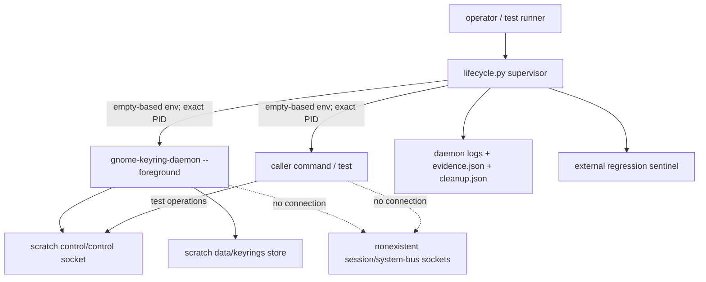
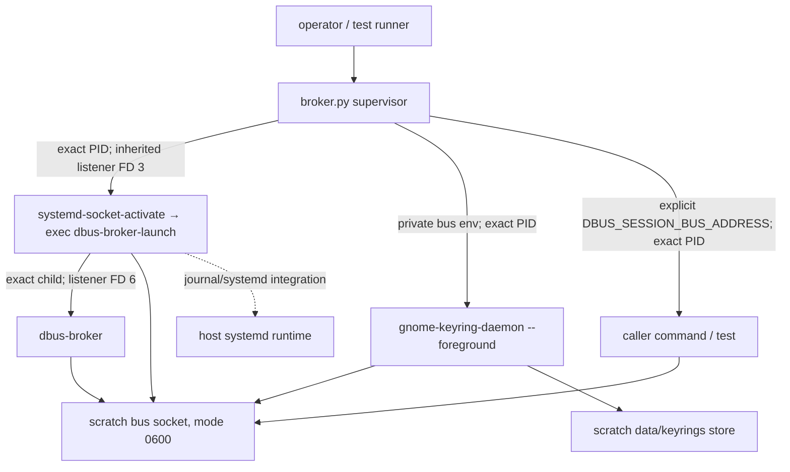
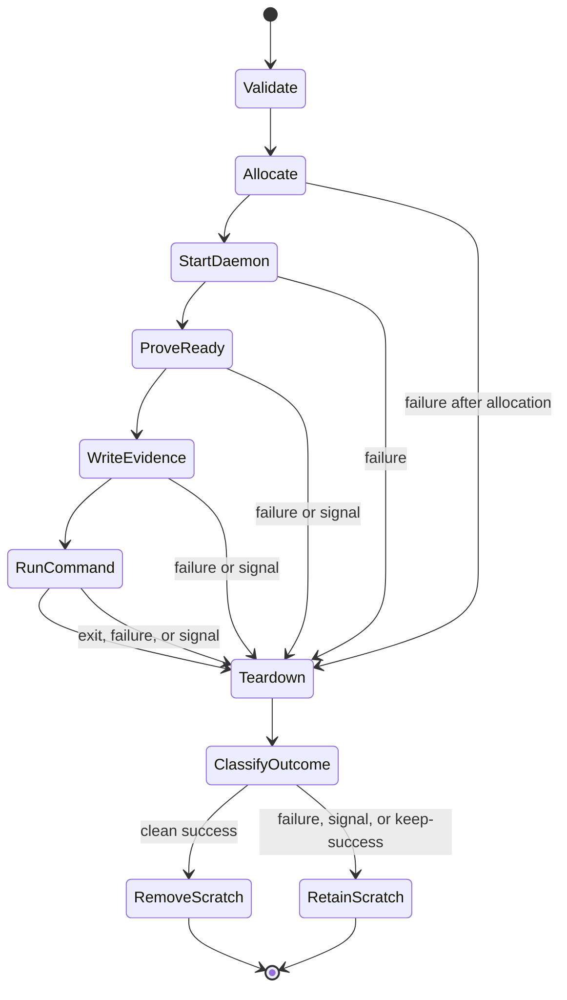

# GNOME Keyring integration harness

The `gmellon` harness makes both the historical private control protocol and
the collection-oriented Secret Service path testable from an ordinary
headless development shell. Both profiles run commands against a fresh,
manually launched `gnome-keyring-daemon` while redirecting keyring storage and
normal desktop discovery away from the user's session. This is a cooperative
test boundary, not access control against the command itself.

For project-wide implementation state, backend policy, release blockers, and
next work, see [`/doc/status.md`](/doc/status.md).

The harness currently provides six executable entry points:

- [`dev/harness/smoke.py`](/dev/harness/smoke.py) proves one isolated
  fresh-UNLOCK and wrong-password-DENIED path.
- [`dev/harness/lifecycle.py`](/dev/harness/lifecycle.py) runs an arbitrary
  command with a fresh isolated daemon and a documented environment contract.
- [`dev/harness/behavior.py`](/dev/harness/behavior.py) characterizes UNLOCK,
  CHANGE, restart persistence, empty passwords, and explicit transport faults
  against the installed daemon without making Secret Service calls.
- [`dev/harness/broker.py`](/dev/harness/broker.py) runs an arbitrary command
  with a private `dbus-broker` and manually launched daemon.
- [`dev/harness/private_bus_probe.py`](/dev/harness/private_bus_probe.py) opens
  a plain Secret Service session and proves GNOME's private collection-password
  interface is exposed, without making a password call.
- [`dev/harness/check`](/dev/harness/check) is the maintained explicit check
  entry point for Rust, control-only Python, and private-broker checks,
  including the multi-collection Rust proof (`rust-broker` mode) and the CLI
  binary proof (`rust-cli` mode).

The control-only core chain is complete: the smoke proof, reusable lifecycle,
installed behavior matrix, and durable Rust-test integration are all
implemented, reviewed, and closed with version-scoped evidence under
[Contract, implementation, and evidence](#contract-implementation-and-evidence).
Private `dbus-broker` coverage was originally optional parity and was promoted
to required infrastructure for the approved zbus Secret Service product
backend. Its lifecycle, interface proof, multi-collection client proof, and
binary `list`/`unlock`/`change` proofs are implemented, independently reviewed,
and closed. It remains a sibling topology that does not block the control-only
harness. See [Private-broker profile](#private-broker-profile).

## Guide map

Use this document as the durable operational and architectural guide. More
specialized sources have narrower authority — see
[Contract, implementation, and evidence](#contract-implementation-and-evidence)
for how that authority divides:

| Need | Start here |
| --- | --- |
| Run or diagnose the current lifecycle | [Quick start](#quick-start), [Lifecycle interface](#lifecycle-interface), and [Troubleshooting](#troubleshooting) |
| Understand the security boundary | [Boundary and invariants](#boundary-and-invariants) and [Process topology](#process-topology) |
| Change lifecycle mechanics | [Lifecycle state model](#lifecycle-state-model), then [`dev/harness/lifecycle.py`](/dev/harness/lifecycle.py) and its [focused tests](/dev/harness/tests/test_lifecycle.py) |
| Run or inspect daemon behavior coverage | [Quick start](#quick-start), [`behavior0.gpt6a.md`](/doc/harness/behavior0.gpt6a.md), and [Evolution guidance](#evolution-guidance) |
| Integrate with Rust or CI | [Durable test integration](#durable-test-integration) and [`integration0.gpt6a.md`](/doc/harness/integration0.gpt6a.md) |
| Run collection-oriented Secret Service tests | [Private-broker interface](#private-broker-interface), [Private-broker profile](#private-broker-profile), [`broker0.gpt6a.md`](/doc/harness/broker0.gpt6a.md), and [`collections0.glm53max.md`](/doc/harness/collections0.glm53max.md) |
| Run or inspect the collection CLI binary proof | [Private-broker workflow](#private-broker-workflow) and [`cli0.glm53max.md`](/doc/harness/cli0.glm53max.md) |
| Run or inspect the collection change CLI proof | [Private-broker workflow](#private-broker-workflow) and [`change0.glm53max.md`](/doc/harness/change0.glm53max.md) |
| Run or inspect the encrypted-session wire proof | [Private-broker workflow](#private-broker-workflow) and [`session0.gpt6a.md`](/doc/harness/session0.gpt6a.md) |

The supported reusable surfaces are the two executable command interfaces and
their exported environments. Importable Python names in `lifecycle.py` and
`broker.py` are implementation details used by focused tests, not stable
library APIs.

## Quick start

Run the foundational smoke proof:

```sh
dev/harness/smoke.py
```

Run the complete installed-daemon behavior matrix:

```sh
dev/harness/behavior.py
```

Add `--keep-success` to retain its four scenario roots and their redacted
`behavior.json` observations.

Run a command inside the reusable lifecycle:

```sh
dev/harness/lifecycle.py -- /usr/bin/env
```

Run a command against the product-relevant private Secret Service bus:

```sh
dev/harness/broker.py -- /usr/bin/env
```

Run the focused plain-session/private-interface proof:

```sh
dev/harness/check broker
```

Run the maintained Rust multi-collection proof against the private bus:

```sh
dev/harness/check rust-broker
```

Run the maintained Rust CLI binary proof, which drives the actual compiled
`gmellon` binary under the private bus:

```sh
dev/harness/check rust-cli
```

See either complete executable contract without allocating a sandbox:

```sh
dev/harness/lifecycle.py --help
dev/harness/broker.py --help
```

Run the maintained Rust transport against two independent real daemons using
nextest:

```sh
dev/harness/check rust-nextest
```

Use `dev/harness/check rust-cargo` for normal Cargo test conventions. Run all
external-tool harness checks, including the Python lifecycle suite, installed
behavior matrix, smoke proof, and private-broker proof, with:

```sh
dev/harness/check all
```

Inspect the selected private control socket from a command:

```sh
dev/harness/lifecycle.py -- \
  /usr/bin/python3 -c \
  'import os; print(os.environ["GMELL_HARNESS_CONTROL_SOCKET"])'
```

Successful runs remove their scratch data by default; preserve a successful
run for inspection with `--keep-success`:

```sh
dev/harness/lifecycle.py --keep-success -- /usr/bin/true
```

Use absolute command paths where practical: the isolated command receives a
fixed `PATH=/usr/bin:/bin`, not the caller's executable search path.

## Lifecycle interface

The executable accepts one command after `--`, optional repeated `--pass-env`
names, and optional successful-run retention:

```text
dev/harness/lifecycle.py [--keep-success] [--pass-env NAME] -- COMMAND [ARG...]
```

The command inherits the caller's current working directory and standard
streams. It does not inherit the caller's environment, has no harness-imposed
runtime deadline, and must not detach descendants. The harness owns daemon
readiness and the lifecycle of its exact children; the command owns its
assertions, its workers, and any timeout its test semantics require.

The exported variables and exit classifications below are the composition
contract. Console diagnostics and the current JSON fields are human/test
evidence, not a versioned interchange schema; promote any field needed by
another maintained tool explicitly, with documentation and acceptance
coverage.

### Host assumptions

The current developer harness assumes Linux/POSIX process and signal semantics,
Unix sockets and peer credentials, readable `/dev/urandom`, a writable
`/home/rektide/tmp-opencode`, Python 3 on `PATH`, and
`gnome-keyring-daemon` discoverable in `/usr/bin:/bin`. Rust entry points also
require Cargo, and the nextest modes require `cargo-nextest`. It is
intentionally host-specific today: portable or packaged integration must make
these prerequisites explicit rather than silently weakening isolation or
searching a caller-controlled daemon path.

The private-broker profile additionally requires `systemd-socket-activate`,
`dbus-broker-launch`, and `gdbus` in `/usr/bin:/bin`, a running host systemd
runtime at `/run/systemd/system`, `/run/systemd/journal/socket`, and
`/run/dbus/system_bus_socket`. The Rust
broker proofs additionally require `busctl` and `stdbuf` there for their
match-filtered Lock-call monitor. These dependencies are launcher/monitor
constraints even though the private config defines no activatable services.
This profile is not portable to a host without those facilities and must not
silently substitute `dbus-daemon` or the real bus.

## Private-broker interface

[`dev/harness/broker.py`](/dev/harness/broker.py) accepts the same command,
retention, selected environment, nesting, stream, and exit contract as the
control-only lifecycle:

```text
dev/harness/broker.py [--keep-success] [--pass-env NAME] -- COMMAND [ARG...]
```

It allocates the same unique private tree, writes a bus config containing no
`<servicedir>`, standard-service-directory, or include directives, starts
`systemd-socket-activate`, and triggers it through an explicit private bus
call. The activator execs `dbus-broker-launch --scope=system` at the same PID;
the launcher then owns one exact `dbus-broker` child. Only after the bus
answers, has no external activatable names, and listener FD ownership is
proved does the harness manually launch `gnome-keyring-daemon`. The command
starts only after that daemon owns both `org.gnome.keyring` and
`org.freedesktop.secrets` at its verified Unix PID.

The focused [`private_bus_probe.py`](/dev/harness/private_bus_probe.py) uses the
explicit address to open a plain Secret Service session and introspect
`/org/freedesktop/secrets`. It requires
`org.gnome.keyring.InternalUnsupportedGuiltRiddenInterface` plus
`UnlockWithMasterPassword` and `ChangeWithMasterPassword`. It sends no
password, makes no lock/unlock/change call, and changes no collection lock
state.

## Command environment

Each child environment is constructed from an empty mapping. The command
receives the private baseline plus these harness variables:

| Variable | Meaning |
| --- | --- |
| `HOME` | private `<root>/home` |
| `XDG_RUNTIME_DIR` | private `<root>/runtime` |
| `XDG_DATA_HOME` | private `<root>/data` using production keyring path selection |
| `XDG_CONFIG_HOME` | private `<root>/config` |
| `XDG_CACHE_HOME` | private `<root>/cache` |
| `XDG_STATE_HOME` | private `<root>/state` |
| `TMPDIR` | private `<root>/tmp` |
| `DBUS_SESSION_BUS_ADDRESS` | unreachable `<root>/missing-session-bus` in `lifecycle.py`; explicit `unix:path=<root>/bus` in `broker.py` |
| `DBUS_SYSTEM_BUS_ADDRESS` | unreachable `<root>/missing-system-bus` |
| `PATH` | fixed `/usr/bin:/bin` |
| `LANG`, `LC_ALL` | fixed `C.UTF-8` |
| `GNOME_KEYRING_CONTROL` | private control directory |
| `GMELL_HARNESS_ACTIVE` | nesting marker, always `1` |
| `GMELL_HARNESS_ROOT` | unique scratch root |
| `GMELL_HARNESS_CONTROL_DIR` | private control directory |
| `GMELL_HARNESS_CONTROL_SOCKET` | exact control socket path |
| `GMELL_HARNESS_DAEMON_PID` | decimal daemon PID |
| `GMELL_HARNESS_DAEMON_STDOUT` | initialization stdout log |
| `GMELL_HARNESS_DAEMON_STDERR` | daemon diagnostics log |
| `GMELL_HARNESS_EVIDENCE` | readiness and isolation evidence |
| `GMELL_HARNESS_CLEANUP` | teardown evidence, written during cleanup |

The private-broker command additionally receives:

| Variable | Meaning |
| --- | --- |
| `GMELL_HARNESS_MODE` | `private-broker` capability marker |
| `GMELL_HARNESS_BUS_SOCKET` | exact private listener path |
| `GMELL_HARNESS_BUS_CONFIG` | minimal no-activation config |
| `GMELL_HARNESS_BROKER_LAUNCHER_PID` | exact launcher PID after socket activator exec |
| `GMELL_HARNESS_BROKER_PID` | exact broker child PID |
| `GMELL_HARNESS_BROKER_STDOUT`, `GMELL_HARNESS_BROKER_STDERR` | private launcher/activator logs |

The daemon receives only the private XDG/bus baseline; it does not receive the
`GMELL_HARNESS_*` command contract. In broker mode the daemon and command keep
`DBUS_SYSTEM_BUS_ADDRESS` on the unreachable scratch path. However,
`systemd-socket-activate` strips that variable before exec: the broker launcher
connects to the real system bus and subscribes to the host systemd manager.
This contact is an explicit host dependency, not an isolation control. Host
service activation remains disabled by the stronger measured invariant: the
private broker config has no service directories and
`ListActivatableNames` contains only `org.freedesktop.DBus`.

### Passing selected host values

Tests may explicitly copy a non-protected caller variable into the command:

```sh
TOKEN=opaque-test-token \
  dev/harness/lifecycle.py --pass-env TOKEN -- /path/to/test-command
```

Isolation, activation, desktop-session, keyring, and harness variables cannot
be overridden. Evidence records the passed variable's name but replaces its
value with an omission marker; the command remains responsible for not
printing sensitive values to its own stdout or stderr.

Value omission protects retained harness JSON; it does not make environment
variables a safe password channel. Generate disposable behavior-test secrets
inside the command or provide product input through an explicitly reviewed
stream, and never use argv or `--pass-env` for keyring passwords.

## Readiness contract

The command starts only after the daemon satisfies all of these checks under
one shared eight-second deadline:

1. initialization stdout reaches EOF while being copied incrementally to its
   private log;
2. the daemon remains alive;
3. startup output reports the explicitly selected control directory;
4. every path reported by the daemon resolves beneath the scratch root;
5. `control/control` exists as a Unix socket owned by the effective UID; and
6. the external sentinel — a regression tripwire kept outside the scratch
   root — remains unchanged.

Socket existence alone is not readiness: GNOME Keyring closes initialization
stdout only after late initialization redirects that stream, and the harness
combines that upstream signal with process and socket checks. The baseline
deliberately tolerates the daemon's unreachable-session-bus diagnostic —
GNOME Keyring 48.0 initializes its control socket and internal store before
that non-fatal failure — but Secret Service itself is unavailable in this
mode.

The private-broker profile first applies a bounded positive bus gate:

1. `systemd-socket-activate` creates the private Unix listener, which the
   harness tightens to mode 0600 beneath the mode-0700 root;
2. `org.freedesktop.DBus.ListNames` answers over the explicit address;
3. `ListActivatableNames` contains only `org.freedesktop.DBus`, proving the
   minimal config did not load host service definitions;
4. the activator has exec'd to the expected `dbus-broker-launch` executable;
5. the launcher has exactly one `dbus-broker` child, identified by parent PID,
   executable, process start ticks, and a pidfd; and
6. both launcher and broker hold FDs for the listener kernel inode.

It then applies the normal daemon readiness gate and finally requires
`GetNameOwner` to return one unique owner for `org.gnome.keyring` and
`org.freedesktop.secrets`; `GetConnectionUnixProcessID` must map that owner to
the exact manually launched daemon PID. The command never starts on socket
existence or name existence alone.

## Exit and retention semantics

| Event | Harness exit | Scratch retention |
| --- | ---: | --- |
| Command exits 0 | `0` | removed unless `--keep-success` |
| Command exits nonzero | exact command status | retained |
| Command dies from signal N | `128 + N` | retained |
| Harness receives HUP, INT, or TERM | `128 + N` after owned cleanup | retained |
| Harness startup, invariant, or cleanup failure | `125` | retained if allocated |
| Invalid lifecycle CLI usage | `2` | not allocated |

Command status 125 is numerically indistinguishable from harness failure 125.
The diagnostic prefix distinguishes `COMMAND FAILURE` from `HARNESS FAILURE`,
and retained JSON records the underlying child status.

The first HUP/INT/TERM is latched without throwing asynchronously, and the
latch remains installed through teardown and evidence writing. Cleanup sends
TERM to all live exact direct children, waits under one shared deadline,
sends KILL only to survivors, waits again, and requires every child to be
reaped; failure to do so is a harness failure. A daemon that exits before
harness-initiated teardown is an error even when it exits zero.

Additional handled signals do not interrupt cleanup, and SIGKILL remains
uncatchable. A sufficiently late signal after all children are reaped may
interrupt success-path scratch removal, but it cannot strand an owned child.
If a signal arrives after `cleanup.json` was written but before the latch is
restored, the process exit can reflect that signal while the earlier teardown
snapshot does not; the process status is the final outcome, and the JSON is
evidence of the cleanup state at write time.

Unexpected Python programming exceptions are deliberately re-raised after the
same cleanup attempt so their traceback remains visible; they are not
normalized into the expected `HARNESS FAILURE` status contract.

## Parallelism and nesting

Independent invocations are parallel-safe: roots, keyring stores, socket
paths, logs, sentinels, and child PIDs are unique, with no fixed writable
paths or shared keyring data. Nesting is deliberately rejected — an
invocation that inherits `GMELL_HARNESS_ACTIVE` returns harness status 125
before allocating a new root or launching a daemon, preventing ambiguous
ownership and control-socket selection. Run independent harness instances
from the outer test runner instead.

## Boundary and invariants

Each invocation creates a short, unpredictable mode-0700 root beneath
`/home/rektide/tmp-opencode`, launches one foreground daemon manually with
its known writable paths redirected into that root, and gives every child an
empty-based explicit environment. The control profile points both D-Bus
addresses at nonexistent scratch sockets. The broker profile provides its own
session socket while keeping the daemon and command system-bus address
nonexistent. Both boundaries are **configuration and session isolation**:

| Invariant | Mechanism and enforcement |
| --- | --- |
| Login keyring, PKCS#11, and all daemon-selected storage stays private | Private `HOME`, `XDG_DATA_HOME`, dedicated config/cache/state directories, and `TMPDIR` beneath the unique root; reported absolute daemon paths must resolve beneath scratch |
| Runtime and control endpoints are invocation-local | Private `XDG_RUNTIME_DIR`, unique control directory, and explicit `--control-directory` |
| Children cannot discover the user's buses through their environment | Addresses are explicit scratch paths; broker mode exposes only its private session listener and keeps the system address dead for daemon/command |
| Host D-Bus service activation is unavailable | Control mode has no bus; broker config has no service directories/includes and `ListActivatableNames` returns only the bus itself |
| Socket activation state is deliberate | Empty-based environments omit inherited `LISTEN_*`, `NOTIFY_SOCKET`, and D-Bus starter state; broker mode starts one exact `systemd-socket-activate` child itself |
| A command never starts against a merely present or stale path | One bounded readiness gate combines all checks in the [readiness contract](#readiness-contract) |
| Process ownership stays narrow | The supervisor signals/reaps exact direct children and tracks the exact broker child by pidfd; no name-based or host-wide cleanup |
| Failure remains inspectable | Nonzero command outcomes, handled signals, and harness failures retain allocated scratch state |
| Concurrent invocations do not share mutable harness state | Every root, store, socket, log, sentinel, and child PID is invocation-specific |
| Ownership is unambiguous | Nesting is rejected before allocation; detached descendants are outside the supported topology |
| Harness artifacts do not intentionally carry protocol secrets | The lifecycle records no command argv, command streams, frames, or explicit pass-through values |

The harness does **not** provide filesystem, network, syscall,
user-namespace, PID-namespace, or cgroup confinement: the command runs with
the caller's UID, capabilities, and working directory, so it can access
anything the caller can. The external sentinel detects one regression
target; it does not prove that arbitrary writes outside scratch are
impossible.

Nor is the evidence tamper-resistant against the command. The command has
the caller's UID, knows its scratch root, and can modify files there. The
sentinel and JSON are regression and diagnosis aids for cooperative tests,
not a security boundary against hostile code.

Do not describe this layer as fully hermetic. A stronger sandbox could be
added deliberately later, but it is not implied by XDG and bus redirection.
The broker profile also intentionally uses the host journal and systemd
launcher facilities; no service definitions are loaded or activated, but that
host dependency prevents a claim of total host independence.

## Process topology



The daemon and command are direct children of the supervisor, each started in
a separate session, and cleanup targets exact PIDs rather than process names,
`pkill`, or broad host process groups. A new session separates terminal and
process-group effects; it does not make descendants supervisor-owned. The
lifecycle does not claim a command's intentionally detached descendants:
integration-test commands must not daemonize and escape supervision, and the
command stops and reaps any workers it creates.

The private-broker sibling adds the following owned topology:



`systemd-socket-activate` is not a fifth long-lived process: the first private
connection makes it `exec` the launcher without changing PID. The supervisor
reaps command, daemon, and launcher directly. It holds a pidfd for the exact
broker child, sends TERM and then KILL only if that identity remains live, and
requires the still-owned launcher to reap its broker before the supervisor
terminates and reaps the launcher. Every wait has a deadline. Failure and
signal tests require all four recorded PIDs to be absent afterward; no
name-based or process-group-wide kill is used.

## Lifecycle state model

The lifecycle is a narrow supervisor with one main transition sequence:



This ordering is part of the architecture:

- argument parsing rejects a missing command before scratch allocation, and
  the nesting guard rejects an already active harness before allocation;
- `evidence.json` is a **pre-command readiness snapshot**, written only after
  the full readiness gate succeeds;
- the command runs only while the original daemon remains live;
- `cleanup.json` is a teardown snapshot attempted after bounded termination
  and reaping, not a transactionally signed final result; and
- outcome classification happens only after cleanup, so cleanup failure can
  turn an otherwise successful command into a harness failure.

A startup failure can therefore retain logs and `cleanup.json` without ever
having produced `evidence.json`; a test must not assume every retained root
has reached readiness.

## Artifacts and secret handling

After readiness, a retained root normally contains:

- `daemon.stdout.log` — startup output, copied incrementally;
- `daemon.stderr.log` — daemon diagnostics, including expected dead-bus
  errors;
- `evidence.json` — pre-command selected paths, sanitized command
  environment, and readiness snapshot;
- `cleanup.json` — command status, handled signal, and per-child teardown;
- private XDG directories and any keyring files created during the run.

Broker-mode roots additionally contain `bus.conf`, the mode-0600 `bus` socket
while live, `broker-launcher.stdout.log`, and
`broker-launcher.stderr.log`. The maintained smoke command writes
`private-bus-probe.json` containing booleans and the public interface name,
never a session secret or password. The Rust proofs' monitors retain only
redacted summaries: `lock-monitor.txt` (header facts from a body-excluding
rule), `change-monitor.txt` (streamed header facts from a password-bearing
rule), and the body monitors' `password-body-monitor.txt` and
`open-session-monitor.txt` (member, sender, array-length, and verdict
facts; their bodies transit pipes only and never exist as files).

Earlier failures may leave only the artifacts opened or written by that
lifecycle state. `cleanup.json` is attempted whenever a root was allocated,
and a failure writing it is itself a harness failure.

The lifecycle records no command argv, command output, control frames, or
explicitly passed environment values, and command streams remain attached to
the caller. Arbitrary daemon diagnostics cannot be generically
secret-classified, so test commands must never ask the daemon to log
passwords or raw frames. The smoke probe uses generated disposable values
and scans retained logs and JSON for both values and complete request frames
before reporting success. The behavior probe scans every regular file in each
retained scenario root. Eventual product tests must use `gmellon`'s zeroizing
secret types, and the lifecycle itself remains unaware of password values.
The broker failure test passes a synthetic sensitive marker into a failing
command, then scans every retained regular artifact and requires that value to
be absent.

## Using the lifecycle in tests

A test command should:

1. read selected paths from `GMELL_HARNESS_*` rather than rediscovering host
   state;
2. keep observations beneath `GMELL_HARNESS_ROOT` when they must survive a
   harness-level failure;
3. use the private `GNOME_KEYRING_CONTROL` directory or exact socket;
4. avoid detached descendants;
5. avoid GUI prompts and Secret Service calls in the control-only layer; and
6. never emit passwords or password-bearing frames.

A private-broker command should additionally use the exported explicit
`DBUS_SESSION_BUS_ADDRESS` (or `GMELL_HARNESS_BUS_SOCKET`) and must not invoke
service activation as a substitute for the manually owned daemon. Capability
probes may open a plain session and introspect the private interface. Product
behavior tests call password methods only with disposable fixtures and
reviewed redaction, as the Rust multi-collection proof now does; they must
never lock an already-unlocked collection as password verification, and any
Lock call belongs to fixture setup under a separately attributed connection.

The lifecycle command interface still starts one daemon per invocation. A
command must not simulate a restart by killing it: every pre-teardown daemon
exit remains a harness failure. Restart and fault characterization belongs to
the sibling [`behavior.py`](/dev/harness/behavior.py) supervisor, which owns
explicit stop/restart and SIGSTOP/SIGCONT transitions while reusing the
lifecycle's internal readiness and exact-PID stop checks. Those Python names
are co-located implementation seams, not a public import contract.

## Running harness checks

### Ordinary Rust workflow

The real-daemon tests are normal Rust integration tests marked `#[ignore]`.
Ordinary workflows stay pure and make the omission visible:

```sh
cargo test
cargo nextest run
```

Cargo reports four tests as `ignored` — two real-daemon control-protocol
tests plus one ignored proof per broker target; nextest reports the same
four as `skipped`. The pure codec unit tests, the fake Unix-socket transport
tests, and the `redaction_scan` positive controls for the shared secret
scanner and streaming monitor parser remain in the ordinary run and never
invoke Python or a system daemon. Do not select only the
ignored test binary without `--run-ignored`: nextest correctly returns its
"no tests to run" status in that narrowed case.

### Explicit real-daemon workflow

Use either maintained wrapper mode from the repository root:

```sh
dev/harness/check rust-nextest
dev/harness/check rust-cargo
```

The corresponding direct conventional commands are:

```sh
cargo nextest run --test real_daemon --run-ignored ignored-only
cargo test --test real_daemon -- --ignored
```

Both tests first validate Linux support, an executable lifecycle, `python3`, a
runnable system `gnome-keyring-daemon`, and readable `/dev/urandom`. The
wrapper additionally validates Cargo and cargo-nextest where applicable. Any
missing or unusable prerequisite is a hard failure with installation or repair
guidance: wrapper preflight exits 125, while a direct Rust command fails its
requested test. Neither path converts a requested integration run into an
ignore or skip.

Each outer Rust test invokes the executable
[`lifecycle.py`](/dev/harness/lifecycle.py) command and re-runs only its own
test binary as the lifecycle command. It does not import Python or reconstruct
the daemon environment. The inner test consumes `GMELL_HARNESS_*` and uses the
public `gmellon::control::SyncClient` to cover:

- fresh UNLOCK, login-file creation, repeated correct UNLOCK, and wrong
  password DENIED; and
- fixture UNLOCK, CHANGE A-to-B, B accepted, and former A denied.

These are transport/product-relevant paths available before the unlock/change
CLI exists. Restart persistence and explicit stopped/unresponsive transitions
remain in `behavior.py`, whose supervisor coherently owns those transitions.

Instances need no test-runner serialization: each ignored test gets a unique
lifecycle root, daemon, control socket, store, and sentinel. Add
`--keep-success` to the wrapper before the mode to retain successful Rust
artifacts, or set `GMELL_HARNESS_KEEP_SUCCESS=1` for a direct Cargo/nextest
command. The retained `rust-integration.txt` contains operation-path labels,
the Rust transport name, secret count, and a post-scan marker only; generated
passwords are zeroized on drop and scanned against every regular file in the
root before success. The same scan runs before an operation assertion panic is
re-thrown, so lifecycle-retained failure artifacts are checked while the
generated values remain available. `--keep-success` also retains the behavior
and smoke roots when used with `python` or `all`.

### Broader Python workflow

The maintained explicit command is:

```sh
dev/harness/check python
```

It compiles the control-only harness Python, runs the focused
lifecycle/behavior tests, then runs the installed behavior matrix and smoke
proof. The wrapper
preflights external tools before calling existing executables; it does not
duplicate lifecycle orchestration. The focused Python tests retain their
convenient unittest skip annotations for direct development invocation, but an
explicit `dev/harness/check` mode fails before unittest if the daemon is
missing. A skip from direct unittest is not evidence of real-daemon coverage.

### Private-broker workflow

The maintained product-relevant D-Bus checkpoint is:

```sh
dev/harness/check broker
```

It hard-preflights the installed broker, socket activator, `gdbus`, daemon,
host journal socket, and systemd runtime; compiles the three broker Python
files; runs five focused lifecycle tests; and then runs the plain-session and
private-interface smoke proof. The tests cover strict environment export,
absence of external activatable names, exact listener-FD and bus-name
ownership, command-failure retention/redaction, signal teardown, and parallel
instances. Direct unittest invocation may skip on a host without the required
facilities, but the explicit wrapper always classifies that as setup failure.

The maintained Rust multi-collection proof is:

```sh
dev/harness/check rust-broker
```

It additionally preflights `busctl` and `stdbuf`, then runs the ignored
[`tests/harness/broker_collections.rs`](/tests/harness/broker_collections.rs)
proof under `broker.py`. The proof's zbus fixture performs the only permitted
mutation setup — private `CreateWithMasterPassword` over the same encrypted
session the product negotiates (one collection labeled
exactly `login`, satisfying the parent acceptance's literal login-plus-second
requirement, plus a second tagged collection) with counted standard `Lock`
calls — while every assertion runs through the public `BlockingClient`. A
match-filtered `busctl monitor` proves ordinary unlock/change never emits a
standard Lock call (that no password method is sent on the already-unlocked
path is the committed client's early return plus the observed outcome, not a
monitor claim); generated passwords are zeroized, excluded from monitor
output by the match rule, and scanned out of every retained regular artifact
by a walk that fails closed on symlinks. Body-scanning monitors add the
encrypted-session wire evidence described under the CLI proof below. See
[`collections0.glm53max.md`](/doc/harness/collections0.glm53max.md) and
[`session0.gpt6a.md`](/doc/harness/session0.gpt6a.md).

The maintained Rust CLI binary proof is:

```sh
dev/harness/check rust-cli
```

It shares the same preflight, then runs the ignored
[`tests/harness/broker_cli.rs`](/tests/harness/broker_cli.rs) proof under
`broker.py`. The same fixture setup creates the literal `login` collection
plus a second tagged collection and locks both, but every observed behavior
belongs to the actual compiled `gmellon` binary, located through the
Cargo-provided `CARGO_BIN_EXE_gmellon` integration-test path (never a hosted
bus or store): `gmellon list` is asserted byte-deterministic with the exact
`login` ID row and no control-protocol artifacts; default and explicit
`unlock --stdin` exit codes and messages cover wrong (2), cross (2), correct
(0), and missing (1) collections; and the already-unlocked path is proven
with `/dev/null` stdin, which the `--stdin` reader would reject as
unterminated — so exit 0 plus the not-checked message proves the pre-resolved
lock state was trusted without reading any secret.

The same proof run also carries the encrypted-session wire evidence, shared
with the collection proof through the same machinery: body-scanning
`busctl monitor` instances watch every member of the private password
interface and every `Service.OpenSession` call, streamed through pipes whose
reader threads reconstruct each `ay` array one zeroized run at a time —
never on disk — and scan every raw line and every decoded run for the
generated passwords. The proof asserts the absence side by construction
(any hit fails the run) and the presence side by exact counts: eleven
encrypted unlock bodies, three encrypted change bodies (cross-checked equal
to the independent header monitor's count), and one encrypted-algorithm
OpenSession per CLI invocation plus the fixture's own, with every captured
password-method call verdicted as the encrypted shape (a 16-byte IV array
plus a non-empty 16-multiple ciphertext array per Secret) so a plain
secret's empty parameters would fail. The scanner is pinned to the
installed busctl rendering by ordinary positive controls in
[`redaction_scan.rs`](/tests/harness/redaction_scan.rs). Retained summaries
(`password-body-monitor.txt`, `open-session-monitor.txt`) carry member,
sender, array-length, and verdict facts only. See
[`session0.gpt6a.md`](/doc/harness/session0.gpt6a.md).

The same proof run also covers `gmellon change` end to end. The three-line
`--stdin` contract is driven directly: mismatched confirmation and truncated
input exit 1, and a second match-filtered monitor counting private
`ChangeWithMasterPassword` method calls proves those rejections never reach
the daemon (exactly the legitimate calls are observed, none from the
fixture); a wrong current password exits 2 while the original password still
unlocks after a fixture-only lock; explicit second-collection A→B and
default-login L→L2 rotations exit 0, keep the collection locked (observed
daemon 48.0 behavior), deny the former password, and accept the new one; a
missing collection exits 1 before stdin is read, established by the
`/dev/null` ordering argument; and the sibling collection's password is
proven untouched. Because the change-call match rule selects
password-bearing bodies — and this host's `busctl monitor` decodes matched
bodies into recoverable `BYTE` dumps — that monitor never writes its output
to disk: stdout is a pipe drained by an owned reader thread that records
only header-derived facts (method-call count and sender unique names) and
discards every other line, including decoded bodies, as it is read. Header
parsing is pinned to the installed busctl header shape and fails closed on
malformed or ambiguous headers; the banner-only stderr readiness log is the
one file that monitor keeps, deleted after the header-derived summary is
written. Captured CLI stdout/stderr and every retained regular artifact are
scanned for all generated passwords in those same forms, and the
match-filtered Lock monitor attributes every standard Lock call to the
fixture connection, so no CLI path locks or relocks. Python remains
lifecycle and check wiring only. See
[`cli0.glm53max.md`](/doc/harness/cli0.glm53max.md) and
[`change0.glm53max.md`](/doc/harness/change0.glm53max.md).

Both broker proofs share their fixture, monitor, secret, and runner machinery
through [`tests/harness/broker_common.rs`](/tests/harness/broker_common.rs),
which builds on the cross-proof helpers in
[`tests/harness/common/mod.rs`](/tests/harness/common/mod.rs) that
`real_daemon.rs` also consumes.

`dev/harness/check all` runs explicit Rust real-daemon tests, the Rust
multi-collection proof, the Rust CLI binary proof, the control-only Python
workflow, and this private-broker workflow.

### Complete static and Rust checks

```sh
sh -n dev/harness/check
python3 -m py_compile \
  dev/harness/smoke.py \
  dev/harness/behavior.py \
  dev/harness/lifecycle.py \
  dev/harness/broker.py \
  dev/harness/private_bus_probe.py \
  dev/harness/tests/test_behavior.py \
  dev/harness/tests/test_lifecycle.py \
  dev/harness/tests/test_broker.py

python3 -m unittest -v \
  dev/harness/tests/test_behavior.py \
  dev/harness/tests/test_lifecycle.py \
  dev/harness/tests/test_broker.py
dev/harness/behavior.py
dev/harness/smoke.py
dev/harness/broker.py -- dev/harness/private_bus_probe.py
cargo nextest run --test broker_collections --run-ignored ignored-only
cargo nextest run --test broker_cli --run-ignored ignored-only

cargo fmt --all -- --check
cargo clippy --all-targets --all-features -- -D warnings
cargo nextest run
```

There is currently no tracked CI configuration in this repository. Operator
policy is therefore explicit rather than presented as an existing CI job:

1. ordinary development runs full `cargo nextest run`, whose summary must
   show the four omitted real-daemon and private-broker proof tests as
   skipped;
2. a provisioned Linux integration environment runs `dev/harness/check all`;
3. missing prerequisites in that explicitly provisioned run are setup
   failures, never allowed skips; and
4. future CI should preserve these as distinct jobs/capabilities rather than
   installing or launching GNOME Keyring in every pure-test job.

## Troubleshooting

### `gnome-keyring-daemon was not found`

Install the system GNOME Keyring daemon in `/usr/bin` or `/bin`. The
lifecycle does not search a user-controlled `PATH`.

### `couldn't connect to dbus session bus`

This diagnostic is expected in the control-only harness: both bus addresses
are intentionally dead. It is a failure only if the daemon exits or the
control socket never becomes ready.

In `broker.py` this diagnostic is a failure: inspect
`broker-launcher.stderr.log`, `daemon.stderr.log`, and `evidence.json` in the
retained root. Never respond by unsetting the explicit address or substituting
the caller's session bus.

### `No medium found` from `dbus-broker-launch --scope=user`

This host returns `ENOMEDIUM` (`-123`) when the isolated inherited-listener
composition selects user scope. The maintained profile deliberately uses the
observed working `--scope=system` mode with zero service definitions and both
launcher bus-address variables redirected to the private listener. Do not
change scope without re-establishing the complete isolation, activation, and
process-ownership evidence.

### Host journal or systemd prerequisite failure

The launcher logs through `/run/systemd/journal/socket` and its scope/activation
model is systemd-specific. `broker.py` and `dev/harness/check broker` fail
clearly when the journal socket or `/run/systemd/system` is absent. This is an
intentional refusal to overstate portability: the mode isolates configuration,
session bus, storage selection, and service activation, but is not independent
of the host service manager and journal.

### Readiness timeout

Inspect the printed retained root, especially `daemon.stdout.log` and
`daemon.stderr.log`. Readiness shares one absolute deadline; time spent
waiting for stdout EOF is not reset before socket validation.

### `nested lifecycle invocation is rejected`

The command inherited `GMELL_HARNESS_ACTIVE`. Run the command directly under
the existing lifecycle, or start another independent harness from the outer
test runner rather than from inside the first command.

### Command unexpectedly exits 125

Look for `HARNESS FAILURE` versus `COMMAND FAILURE` and inspect
`cleanup.json`. Daemon termination initiated by a lifecycle command is a
harness failure by design; explicit restart and fault transitions belong to
`behavior.py`.

### Retained directories accumulate

Failure retention is deliberate, and the harness does not prune stale data
or processes automatically. Inspect and remove only roots you have identified
as safe; never use broad name-based process cleanup.

## Contract, implementation, and evidence

These sources answer different questions and should not be flattened into
one kind of truth:

| Source | Role |
| --- | --- |
| This guide and `lifecycle.py --help` | Current operator-facing lifecycle contract |
| [`dev/harness/lifecycle.py`](/dev/harness/lifecycle.py) | Executable mechanics; the final authority on what the current revision actually does |
| [`dev/harness/broker.py`](/dev/harness/broker.py) and its [focused tests](/dev/harness/tests/test_broker.py) | Executable private-broker mechanics, command contract, exact process/FD ownership, and acceptance coverage |
| [`dev/harness/private_bus_probe.py`](/dev/harness/private_bus_probe.py) | Non-password plain-session and private-interface capability proof |
| [`dev/harness/check`](/dev/harness/check) | Maintained explicit prerequisite and check composition; delegates lifecycle/process orchestration |
| [`tests/harness/real_daemon.rs`](/tests/harness/real_daemon.rs) | Ignored Rust integration boundary and real `SyncClient` assertions |
| [`tests/harness/broker_collections.rs`](/tests/harness/broker_collections.rs) | Ignored Rust multi-collection proof under the private broker: zbus fixture setup plus `BlockingClient` behavior and no-relock wire evidence |
| [`tests/harness/broker_cli.rs`](/tests/harness/broker_cli.rs) | Ignored Rust CLI binary proof under the private broker: the compiled `gmellon` binary's list/unlock/change exit codes, messages, no-read paths, no-change wire evidence, and secret scans |
| [`dev/harness/tests/test_lifecycle.py`](/dev/harness/tests/test_lifecycle.py) | Executable acceptance coverage for lifecycle invariants and races |
| [`dev/harness/behavior.py`](/dev/harness/behavior.py) and its [black-box test](/dev/harness/tests/test_behavior.py) | Reproducible installed-daemon control matrix plus explicit behavior-owned restart/fault transitions |
| [`smoke0.gpt6a.md`](/doc/harness/smoke0.gpt6a.md) | Version-scoped installed-daemon evidence for the first UNLOCK/denial path and exact-PID cleanup; evidence, not timeless daemon promises |
| [`lifecycle0.gpt6a.md`](/doc/harness/lifecycle0.gpt6a.md) | Version-scoped lifecycle, signal-race, environment, retention, and test evidence; evidence, not timeless daemon promises |
| [`behavior0.gpt6a.md`](/doc/harness/behavior0.gpt6a.md) | Version-scoped UNLOCK, CHANGE, restart, empty-password, stopped, and unresponsive observations; evidence, not timeless daemon promises |
| [`integration0.gpt6a.md`](/doc/harness/integration0.gpt6a.md) | Version-scoped durable entry-point, skip/fail, Rust transport, parallel-isolation, and retained-artifact evidence |
| [`broker0.gpt6a.md`](/doc/harness/broker0.gpt6a.md) | Version-scoped private broker, daemon name ownership, plain-session/interface, host-dependency, failure-retention, and cleanup evidence |
| [`collections0.glm53max.md`](/doc/harness/collections0.glm53max.md) | Version-scoped multi-collection `BlockingClient` proof: stable-ID unlock/change, fixture-only locking, no-relock monitor evidence, and secret-handling limits |
| [`cli0.glm53max.md`](/doc/harness/cli0.glm53max.md) | Version-scoped CLI binary proof: `gmellon list` determinism, default/explicit unlock exit semantics, no-read already-unlocked evidence, and secret scans |
| [`change0.glm53max.md`](/doc/harness/change0.glm53max.md) | Version-scoped change CLI binary proof: three-line stdin contract, no-private-call wire evidence for input rejections, exit 2/0 rotation semantics, locked-change daemon behavior, and the never-on-disk streaming policy for the password-bearing monitor |
| [`session0.gpt6a.md`](/doc/harness/session0.gpt6a.md) | Version-scoped encrypted-session implementation and wire proof: pinned DH/HKDF known answers, first-live-run interop facts, body-scan monitor design and positive controls, and exact check results |
| [`prompt.md`](/doc/harness/prompt.md) | Epic safety invariants, upstream facts, ticket boundaries, and the original work graph, plus a completion-status section; planned acceptance, not completion evidence |
| Product [`README.md`](/README.md) | Product contract, private wire protocol, and the unlock-or-create hazard that motivates real-daemon testing; not the harness lifecycle contract |
| Beads graph | Review and work status; not runtime behavior |

When mechanics change, update implementation, focused tests, `--help`, and
this guide together. Record new installed-daemon behavior in a new or clearly
revised evidence document with binary and platform context; a source reading
can motivate a test but must not be promoted to an installed-binary behavior
claim without observation. Before extending the harness, check
`bd show gmell-harness` and the ready Beads frontier — behavioral claims
belong in evidence only after observation against the installed daemon.

## Evolution guidance

The control-only core chain — smoke proof, reusable lifecycle, control-protocol
behavior matrix, durable test integration, and documentation reconciliation —
is complete and reviewed. The harness deliberately does not implement
`gmellon unlock` or `change`, use the real session bus temporarily, launch a
GUI prompter, rename real keyrings, clean unrelated processes or data, or
make broker mechanics Rust product dependencies. The private-broker profile
branched independently after lifecycle and has been promoted to required work
for the zbus Secret Service product backend; it still must not gate any direct
control-protocol test, and only that branch may make non-prompting Secret
Service observations.

The current deep interface is deliberately small: launch a fresh isolated
daemon, prove readiness, run one command under a strict environment
contract, and classify the result after owned teardown. Extend orchestration
behind that interface rather than teaching product code about daemon startup,
scratch layout, broker activation, or harness JSON.

### Behavior characterization

- Keep wire operations and assertions in a disposable probe or reviewed Rust
  client; keep process, path, readiness, and cleanup ownership in the
  harness.
- Record results as installed-daemon evidence, including version and
  platform. Do not turn one observation into an unqualified upstream
  guarantee.
- Preserve the unexpected-daemon-exit invariant. The implemented behavior
  supervisor stops and reaps the exact owned daemon, preserves its private
  store in place, starts a new generation, and repeats readiness. The general
  lifecycle contract does not expose root reuse or seed copying.
- Model stopped and unresponsive cases only through the implemented explicit
  supervisor stop and SIGSTOP/SIGCONT fault transitions. Arbitrary daemon death
  remains a lifecycle and behavior failure.
- Keep control-only behavior free of Secret Service calls.

Installed 48.0 results and limitations are recorded in
[`behavior0.gpt6a.md`](/doc/harness/behavior0.gpt6a.md); they must not be
generalized into timeless upstream guarantees.

### Durable test integration

- Keep the ignored Rust tests as thin lifecycle-command clients: consume
  `GMELL_HARNESS_*`, use public product transport, and leave daemon mechanics
  behind the executable Python contract.
- Add future product cases to [`tests/harness/real_daemon.rs`](/tests/harness/real_daemon.rs)
  when one fresh daemon is coherent. Put explicit restarts and fault injection
  behind a supervisor-owned executable rather than killing lifecycle children
  from Rust.
- Preserve the ordinary ignored/skipped signal and explicit hard-failure
  prerequisite contract. Never add tool-detection that returns early from an
  explicitly selected test.
- Preserve one unique lifecycle per test. Serialize only after demonstrating
  a genuinely shared external resource.
- Keep generated secrets inside the inner Rust process, zeroizing their owned
  buffers and scanning retained regular artifacts without printing values or
  password-bearing frames.

### Private-broker profile

The private broker is a sibling topology profile, not an upgrade that makes
the control-only baseline depend on D-Bus. It was planned as optional parity
and was promoted to required P1 infrastructure because the approved product
architecture targets Secret Service collections through zbus and GNOME's
private internal interface. That promotion does not change or gate direct
control-socket tests.

The reusable lifecycle/proof checkpoint is implemented. `broker.py` owns one
unique listener, the launcher PID, its exact broker child, the manually
launched daemon, and the command. It preserves private HOME/XDG/storage paths,
empty-based environments, bounded readiness, exact teardown, retained failure
evidence, and no external activatable names. It identifies itself with
`GMELL_HARNESS_MODE=private-broker` rather than changing the meaning of the
control-only entry point.

Keep the `dbus-broker-launch` systemd and journal dependencies visible. If they
prevent startup on a host, report that limitation rather than using the real
bus or substituting `dbus-daemon`. Broker mechanics stay outside Rust product
dependencies.

The next coherent slice was product-level collection fixture coverage; it is
now implemented as
[`tests/harness/broker_collections.rs`](/tests/harness/broker_collections.rs)
with version-scoped evidence in
[`collections0.glm53max.md`](/doc/harness/collections0.glm53max.md). The
proof creates the literal `login` collection (exact stable ID `login`,
persisted as `login.keyring`) plus a second disposable collection under the
private daemon through fixture-only private creation plus counted standard
locks, exercises the product zbus client against stable collection IDs, and
demonstrates that ordinary unlock inspects lock state and returns
already-unlocked without locking, relocking, or pretending to verify the
supplied password. Password methods are invoked only for actually locked
fixtures, with generated values excluded from logs, argv, environment, and
retained artifacts — the final artifact scan reads every regular file
present at scan time beneath the harness root and fails closed on any
symlink — with a match-filtered monitor attributing every standard Lock call
to the fixture connection.

The CLI-facing slice extends the same fixture to the shipped binary:
[`tests/harness/broker_cli.rs`](/tests/harness/broker_cli.rs) runs the
actual compiled `gmellon` through `CARGO_BIN_EXE_gmellon` against the same
isolated fixtures, with version-scoped evidence in
[`cli0.glm53max.md`](/doc/harness/cli0.glm53max.md). The shared fixture,
monitor, secret, and runner machinery now lives in
[`tests/harness/common/mod.rs`](/tests/harness/common/mod.rs) and
[`tests/harness/broker_common.rs`](/tests/harness/broker_common.rs) so
further proof slices extend instead of duplicating it.

The change slice extends that binary proof to `gmellon change`, with
version-scoped evidence in
[`change0.glm53max.md`](/doc/harness/change0.glm53max.md) (including its GX
hardening addendum). Its wire-evidence tool — a monitor matching the
password-bearing private `ChangeWithMasterPassword` member — is deliberately
held to a stricter artifact policy than the body-excluding Lock monitor:
its stdout is a pipe consumed by an owned streaming reader that retains only
header-derived counts and sender names, so password-bearing output never
exists on disk in any form — not on success, not on failure paths, not
through a panic unwind or abrupt teardown. Header parsing is pinned to the
installed busctl shape, fails closed on malformed or ambiguous headers, and
is covered by the ordinary `redaction_scan` positive controls together with
the scanner's detection side. Keep that split policy for any future monitor
whose match rule selects password-bearing bodies.
