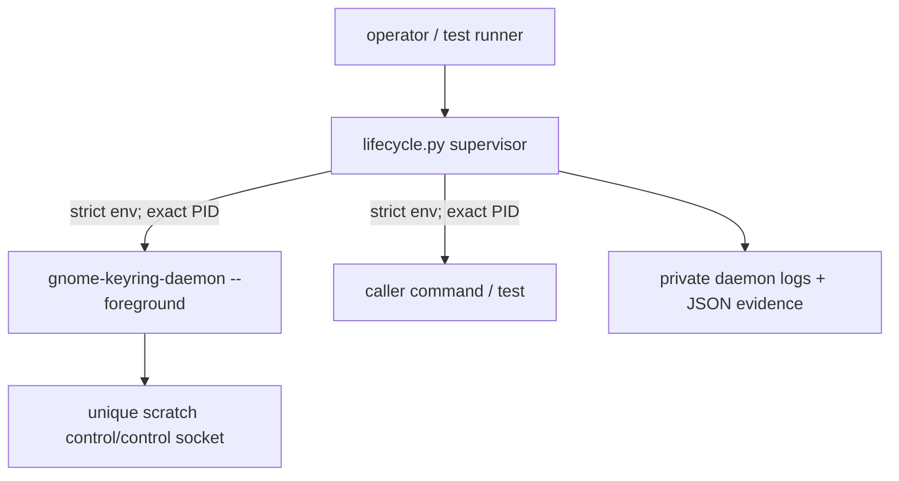

# Reusable control-only harness lifecycle result

## Result

[`dev/harness/lifecycle.py`](/dev/harness/lifecycle.py) now runs one caller
command with one fresh manually launched `gnome-keyring-daemon`. It preserves
the reviewed smoke proof's strict environment construction, poisoned D-Bus
addresses, bounded positive readiness, private unique paths, external
sentinel, retained daemon diagnostics, and exact-child teardown. The original
[`dev/harness/smoke.py`](/dev/harness/smoke.py) remains unchanged and still
passes its fresh UNLOCK-then-DENIED proof.

The operator interface is:

```sh
dev/harness/lifecycle.py [--keep-success] [--pass-env NAME] -- COMMAND [ARG...]
```

For example, a test can inspect the selected control socket without inheriting
the operator's desktop session:

```sh
dev/harness/lifecycle.py -- \
  /usr/bin/python3 -c \
  'import os; print(os.environ["GMELL_HARNESS_CONTROL_SOCKET"])'
```

Both the executable's `--help` output and this evidence define the current
contract. The broader durable harness guide is intentionally left for parent
architectural review.

## Process topology and ownership



The harness directly owns and reaps the daemon and command PIDs. Each starts a
new session, separating it from the operator's process group. Cleanup first
polls both exact children, sends TERM to every remaining exact PID, waits one
shared three-second deadline, sends KILL only to survivors, waits a second
bounded deadline, and reaps each direct child. An abnormal daemon status is a
harness failure and remains visible in `cleanup.json`. A daemon that exits
before harness-initiated TERM is also a harness failure even when its status is
zero; this closes the command-completion/daemon-exit boundary race.

The lifecycle does not claim ownership of arbitrary descendants that a caller
deliberately daemonizes or moves into another process topology. Commands used
as tests must keep their own workers structured beneath the command and must
not intentionally escape. Process namespaces or cgroups would be needed for a
stronger descendant-containment claim.

## Exact isolation boundary

Both children receive environments assembled from an empty mapping. The
daemon receives only its private path, poisoned-bus, locale, and fixed search
path settings. The command receives that baseline plus the selected harness
paths below. Thus host `LISTEN_*`, `NOTIFY_SOCKET`, `GNOME_KEYRING_CONTROL`,
`SSH_AUTH_SOCK`, `DBUS_STARTER_*`, desktop startup/autostart variables, and
session identifiers are absent by construction rather than selectively
removed.

Every instance creates an unpredictable mode-0700 `gmell-h-*` root beneath
`/home/rektide/tmp-opencode`, with private `home`, `runtime`, `data`, `config`,
`cache`, `state`, `tmp`, and `control` children. Both D-Bus addresses name
nonexistent sockets under that root. Readiness validates every path reported
by the daemon, the control socket's type and effective-UID ownership, and an
external sentinel. No `GNOME_KEYRING_TEST_PATH` shortcut is used.

This is **configuration and session isolation**, not filesystem, network,
process-namespace, or syscall confinement. The command intentionally runs in
the caller's working directory and can access anything allowed by the caller's
UID. The sentinel and path checks are regression evidence for known daemon
writes, not proof that arbitrary writes outside scratch are impossible.

## Exported command environment

The command always receives:

| Variable | Contract |
| --- | --- |
| `HOME` | private `<root>/home` |
| `XDG_RUNTIME_DIR` | private `<root>/runtime` |
| `XDG_DATA_HOME` | private `<root>/data`; production keyring selection |
| `XDG_CONFIG_HOME` | private `<root>/config` |
| `XDG_CACHE_HOME` | private `<root>/cache` |
| `XDG_STATE_HOME` | private `<root>/state` |
| `TMPDIR` | private `<root>/tmp` |
| `DBUS_SESSION_BUS_ADDRESS` | unreachable `<root>/missing-session-bus` |
| `DBUS_SYSTEM_BUS_ADDRESS` | unreachable `<root>/missing-system-bus` |
| `PATH` | fixed `/usr/bin:/bin` |
| `LANG`, `LC_ALL` | fixed `C.UTF-8` |
| `GNOME_KEYRING_CONTROL` | private control directory, not the socket pathname |
| `GMELL_HARNESS_ACTIVE` | `1`; also the nesting guard |
| `GMELL_HARNESS_ROOT` | unique mode-0700 scratch root |
| `GMELL_HARNESS_CONTROL_DIR` | private control directory |
| `GMELL_HARNESS_CONTROL_SOCKET` | exact `<control-dir>/control` socket |
| `GMELL_HARNESS_DAEMON_PID` | decimal exact daemon PID |
| `GMELL_HARNESS_DAEMON_STDOUT` | initialization stdout log path |
| `GMELL_HARNESS_DAEMON_STDERR` | daemon diagnostic log path |
| `GMELL_HARNESS_EVIDENCE` | readiness/isolation JSON path |
| `GMELL_HARNESS_CLEANUP` | teardown JSON path; created during teardown |

`--pass-env NAME` explicitly copies a non-protected caller variable into the
command environment. Isolation, activation, session, and all
`GMELL_HARNESS_*` variables cannot be passed or overridden. Passed values are
available to the command but omitted from evidence; only their names are
recorded. Absolute executable paths are preferred because the fixed `PATH`
does not include user tool directories.

## Readiness and exit semantics

The command starts only after all of these positive checks complete under an
eight-second deadline:

1. daemon initialization stdout reaches EOF and is copied to its log;
2. the daemon is still live;
3. the daemon reports the explicitly selected control directory;
4. every reported path resolves beneath scratch; and
5. `control/control` exists as a Unix socket owned by the effective UID.

Exit behavior is:

| Event | Lifecycle status | Retention |
| --- | ---: | --- |
| command exits normally | exact command status | remove only on status 0 unless `--keep-success` |
| command dies from signal N | `128 + N` | retain |
| harness receives first HUP/INT/TERM N | `128 + N` after teardown | retain |
| startup, invariant, launch, or cleanup failure | `125` | retain if allocation occurred |
| invalid CLI usage | argparse status `2` | no allocation |

A command that itself exits 125 is propagated as 125 and is therefore
numerically indistinguishable from a harness failure; the diagnostic prefix
and retained JSON distinguish the source.

## Signal-race correction

The smoke proof's handler raised an exception asynchronously. A first signal
arriving after entry into `finally` could therefore interrupt the very
TERM/KILL/wait sequence intended to make signal handling safe.

The lifecycle installs a first-signal latch instead. Its handler only stores
the first signal number. Normal polling points turn a pending signal into
orderly unwinding, but the handler never throws. It remains installed through
TERM, bounded waiting, survivor-only KILL, reaping, log closure, sentinel
validation, and cleanup-record writing. Additional handled signals are
ignored by the latch; SIGKILL remains uncatchable. A deterministic test sends
SIGTERM from a cleanup-entry hook and proves the daemon and already-completed
command are both reaped before status 143 is returned.

## Parallelism, nesting, and artifacts

Two simultaneous test instances produced different scratch roots, daemon
PIDs, and control socket paths. There are no fixed writable paths, socket
names, PID files, or shared keyring directories.

Nesting is deliberately **rejected**, not emulated. An inner invocation sees
the exported `GMELL_HARNESS_ACTIVE` marker and returns harness status 125
before allocating scratch or launching another daemon. This avoids ambiguous
control-path and ownership contracts while still allowing unrelated harness
instances to run concurrently.

Success removes scratch unless `--keep-success` is selected. Command failure,
handled signal, and harness failure retain the mode-0700 root and print its
path. The harness captures only daemon lifecycle streams; command stdout and
stderr remain caller-owned and are never copied into artifacts. Evidence does
not record command argv, protocol frames, or explicit pass-through values.
Tests used an opaque marker to confirm it was absent from daemon logs,
`evidence.json`, and `cleanup.json` on command failure. As with the smoke
proof, callers must never deliberately print or pass passwords through argv.

## Verification

Observed on Linux 7.1.0-debplus.1 with Python 3.14.6 and the installed
`gnome-keyring-daemon` 48.0 (`testing: enabled`):

```sh
python3 -m py_compile \
  dev/harness/lifecycle.py \
  dev/harness/tests/test_lifecycle.py
python3 -m unittest -v dev/harness/tests/test_lifecycle.py
dev/harness/smoke.py
cargo fmt --all -- --check
cargo clippy --all-targets --all-features -- -D warnings
cargo nextest run
```

All nine focused lifecycle tests passed. They cover strict exports, normal
cleanup, command status propagation and failure retention, failure-artifact
value omission, concurrent disjoint instances, nesting rejection, live signal
teardown, first-signal-during-finally teardown, and TERM-to-KILL escalation for
only a surviving TERM-ignoring command. They also reject a daemon that exits
before owned teardown even with status zero. The unchanged smoke proof passed.
Rust format and Clippy passed; nextest ran 54 tests with 54 passed and no skips.

## Known limitations and next slice

- The harness requires Linux/POSIX process and Unix-socket behavior plus an
  installed `/usr/bin` or `/bin` `gnome-keyring-daemon`.
- The command has configuration/session isolation but no filesystem or process
  namespace confinement and no command timeout.
- Exact ownership covers the two direct children; intentionally detached
  command descendants are outside the supported topology.
- There is no private D-Bus broker. Both bus addresses are deliberately dead,
  so Secret Service behavior cannot be tested here.
- The lifecycle establishes safe composition, not the broader control
  behavior matrix.

The next coherent core ticket is `gmell-harness-behavior`, which can now invoke
focused protocol probes through this lifecycle to record installed-daemon
UNLOCK, CHANGE, restart, empty-password, and stopped-daemon behavior. Optional
private-broker parity remains a separate branch.

## Cross-references

- [`/doc/harness/prompt.md`](/doc/harness/prompt.md) defines the epic safety
  invariants and keeps behavior, durable integration, docs, and optional
  broker parity in separate reviewed tickets.
- [`/doc/harness/smoke0.gpt6a.md`](/doc/harness/smoke0.gpt6a.md) records the
  predecessor proof whose readiness, isolation, protocol, and exact-daemon
  cleanup observations were preserved here.
- [`/README.md`](/README.md) is the product-level source for the control
  protocol's role, the login keyring, and the unlock-or-create hazard. This
  lifecycle does not alter those product behaviors.
