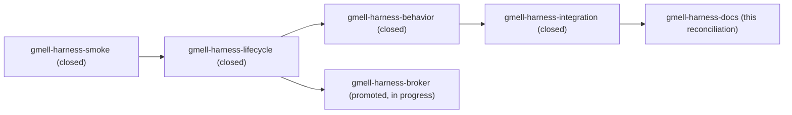

# Isolated GNOME Keyring harness

This document records the design, evidence, and implementation guidance for
the `gmell-harness` Beads epic in the `gmellon` repository.

## Total mission

`gmellon` is a small Rust CLI that lists, unlocks, or changes the password of
any GNOME Keyring Secret Service collection by stable ID. The approved product
architecture uses zbus with the standard Secret Service interfaces plus
GNOME's private
`org.gnome.keyring.InternalUnsupportedGuiltRiddenInterface`. The product must
be safe to use from a headless shell and must be tested without touching the
user's real keyrings, session bus, or socket-activated daemon. Read
[`/README.md`](/README.md) for the evolving product spec and inspect the Beads
graph before acting.

This epic owns the reusable integration-test harness, not the Rust product
implementation. The historical control-only baseline is a configuration- and
session-isolated process topology containing:

1. one manually launched `gnome-keyring-daemon`,
2. a private mode-0700 home/runtime/data tree,
3. explicit unreachable scratch addresses for both session and system D-Bus,
   and
4. a command or test process that can safely exercise the daemon's control
   socket.

The product-relevant sibling replaces the dead session address with a unique
private `dbus-broker` listener, adds exact launcher/broker ownership, and does
not start its command until the bus answers and the manually launched daemon
owns both required names.

The older control-only profile remains useful historical and transport
coverage, but it cannot exercise collection-targeted product behavior. The
private `dbus-broker` profile is therefore required by the zbus-only product
architecture. It must never inherit the real user bus. Do not start
`gnome-settings-daemon`; the relevant process is a manually launched
`gnome-keyring-daemon`.

## How to run this work

Work the frontier of the Beads graph **one reviewed ticket at a time**. At each
consequential checkpoint:

- summarize what became possible or impossible;
- explain the process topology and isolation boundary actually observed;
- cite source paths and commands that support the conclusion;
- identify unresolved risks or choices;
- propose exactly one next coherent ticket; and
- stop for the human to review before continuing.

Do not accept a request to "do the harness" as permission to run every ticket
unattended. Small investigation edits within the current ticket are fine.
Commit each coherent, useful stage with `jj commit -m "..." <paths...>` before
asking for review. Preserve failed spikes in `.test-agent/harness/` when their
evidence is useful; do not overwrite unrelated or provisional work.

## Current state and known facts

Status at 2026-09-11 documentation reconciliation (`gmell-harness-docs`):

- The core chain is implemented, reviewed, and closed in Beads:
  `gmell-harness-smoke`, `gmell-harness-lifecycle`,
  `gmell-harness-behavior`, and `gmell-harness-integration`, with
  version-scoped evidence in [`smoke0.gpt6a.md`](/doc/harness/smoke0.gpt6a.md),
  [`lifecycle0.gpt6a.md`](/doc/harness/lifecycle0.gpt6a.md),
  [`behavior0.gpt6a.md`](/doc/harness/behavior0.gpt6a.md), and
  [`integration0.gpt6a.md`](/doc/harness/integration0.gpt6a.md).
- The durable operator and architecture contract is
  [`/doc/harness/README.md`](/doc/harness/README.md). This prompt remains the
  kickoff plan and safety-invariant record — planned acceptance, not
  completion evidence.
- `gmell-harness-broker` was promoted from optional parity to P1 and remains in
  progress. Its reusable private-broker lifecycle and plain-session/private-
  interface proof are implemented in [`dev/harness/broker.py`](/dev/harness/broker.py)
  and recorded in [`broker0.gpt6a.md`](/doc/harness/broker0.gpt6a.md). Product
  collection fixtures and zbus behavior are the proposed next slice. It still
  does not gate the control-only harness, its core closure, or direct
  control-socket tests.
- The per-ticket sections and the closing kickoff directive below are the
  original reviewed plan, preserved for provenance; live status lives in the
  Beads graph.

The facts recorded at kickoff follow.

- Stage 0 is complete: Cargo, a clap command skeleton, and three nextest tests
  exist. The harness should not need to restructure that code.
- `gmell-harness` is the umbrella epic. Its historical control-only chain is
  smoke, lifecycle, behavior, durable integration, and documentation. The
  broker branch still reuses lifecycle policy, but the product pivot promotes
  it from optional parity to required zbus integration support.
- Installed tools presently include `dbus-broker-launch` 37,
  `systemd-socket-activate`, `dbus-run-session`, `dbus-daemon`,
  `gnome-keyring-daemon` 48.0, `gdbus`, and `secret-tool`.
- Direct control-socket operation does not require D-Bus. The daemon creates
  its control socket and initializes its internal PKCS#11 store before its
  non-fatal session-bus setup. The required first harness must therefore
  poison both bus addresses rather than introduce a broker immediately.
- `dbus-broker-launch` does **not** create its own listener. Its parent must
  pass exactly one socket using the systemd socket-activation protocol, and
  `<listen>` entries in a D-Bus config are ignored.
- `dbus-broker-launch` uses systemd for D-Bus service activation. The harness
  must not expose host service directories or permit activation of the real
  `org.freedesktop.secrets` service. Prefer a minimal custom bus config and
  manually launch the test daemon. The launcher also opens a controller
  connection to the selected host systemd instance; verify that the proposed
  topology cannot create or manipulate host units. If "no host systemd
  contact" is a hard boundary, surface that `dbus-broker-launch` may not meet
  it rather than hiding the caveat or silently falling back.
- An assessment spike succeeded with `systemd-socket-activate`, a minimal
  no-activation config, `--scope system`, and `DBUS_SYSTEM_BUS_ADDRESS`
  redirected to the private bus. On this host, `--scope user` failed with
  `ENOMEDIUM`, and the launcher also required `/run/systemd/journal/socket`.
  Reproduce and document these constraints; do not describe this composition
  as fully hermetic or portable.
- Upstream GNOME Keyring tests use GLib's `GTestDBus` (normally a private
  `dbus-daemon`) plus scratch directories and a manually launched daemon.
  Those tests are useful prior art, but they do not prove the broker topology.
- The daemon option is `--control-directory`, not `--control-dir`.
- On startup, the daemon initializes its internal PKCS#11 stack and attempts
  session-bus setup. Bus failure is currently non-fatal for the control
  socket; the `secrets` D-Bus API itself needs a functioning session bus.
- Do not pass `--components=`. An absent or empty value is replaced with the
  daemon's default component set.
- Upstream debug builds honor `GNOME_KEYRING_TEST_PATH`; this installed daemon
  reports `testing: enabled`. That variable is useful corroboration, but it is
  compile-time debug behavior and cannot be the only isolation mechanism.
  Redirect `HOME`, `XDG_DATA_HOME`, `XDG_CONFIG_HOME`, `XDG_CACHE_HOME`,
  `XDG_STATE_HOME`, `XDG_RUNTIME_DIR`, and preferably `TMPDIR` before spawning
  any child. Do not set `GNOME_KEYRING_TEST_PATH` in the final `gmellon`
  end-to-end tests: it bypasses the production XDG keyring path that
  `--allow-create` must inspect.
- A control connection begins with a separate NUL credential byte. The daemon
  consumes that byte, checks the peer UID, and only then reads the framed
  request. Any probe must model this transport prelude.
- Source says `CHANGE` creates a missing login keyring using the new password,
  and rejects an empty new password. Record what the installed binary does;
  do not let a source reading substitute for the behavioral test.
- Control-socket existence is not sufficient readiness. Upstream captures
  daemon stdout and waits for EOF, which occurs when late initialization
  redirects stdout to stderr. Combine that EOF with child-liveness and socket
  type/ownership checks, all under a deadline.

Primary local source is under `~/archive/GNOME/gnome-keyring/`; check it before
the web. Especially inspect:

- `daemon/control/gkd-control-server.c`
- `daemon/control/gkd-control-client.c`
- `egg/egg-unix-credentials.c`
- `daemon/gkd-main.c`
- `daemon/gkd-test.c`
- `daemon/test-startup.c`
- `daemon/dbus/test-service.c`
- `pam/test-pam.c`
- `pam/gkr-pam-client.c`
- `daemon/login/gkd-login.c`
- `pkcs11/gkm/gkm-util.c`

Also use the installed `dbus-broker-launch(1)`,
`systemd-socket-activate(1)`, and `gnome-keyring-daemon(1)` manuals as primary
documentation for the binaries actually under test.

## Safety invariants

Treat these as acceptance criteria, not aspirations:

- Create a short, unique scratch root under `/home/rektide/tmp-opencode` with
  `umask 077`; keep Unix socket path-length limits in mind.
- Every child receives an explicit environment assembled from the harness
  contract. Do not merely override two variables in the inherited session.
- Set `DBUS_SESSION_BUS_ADDRESS` and `DBUS_SYSTEM_BUS_ADDRESS` to explicit
  nonexistent sockets under the scratch root for the baseline harness;
  unsetting them is insufficient because GLib can rediscover host buses.
- Sanitize inherited `LISTEN_*`, `NOTIFY_SOCKET`, `GNOME_KEYRING_CONTROL`,
  `SSH_AUTH_SOCK`, `DBUS_STARTER_*`, `DESKTOP_AUTOSTART_ID`, and
  `XDG_SESSION_ID` before startup.
- The private bus config must not load standard or host service directories.
  Only the harness launches `gnome-keyring-daemon`.
- The test daemon's control socket, keyring files, and other known writable
  paths must resolve beneath the scratch root. Record the daemon environment
  and selected paths as evidence. This verifies the configured storage
  boundary; without filesystem confinement it does not prove that arbitrary
  writes outside scratch are impossible.
- Establish readiness with bounded waits and positive checks. For the
  baseline, require initialization stdout EOF, child liveness, and the
  expected socket type and owner. For the private-broker profile, additionally
  prove that the broker answers and the intended daemon owns its private bus
  names.
- Manage exact child PIDs or one dedicated process group. Never use broad
  `pkill`, `killall`, or name-based cleanup.
- On normal and signal exits, send TERM, wait with a deadline, then KILL only
  the remaining owned children. Reap them and report abnormal exits.
- Make instances parallel-safe. No fixed socket names, PIDs, or shared data
  directories.
- Preserve child logs on failure. Never print passwords or password-bearing
  frame bytes.
- Include an isolation regression check that fails if a sentinel outside the
  scratch root changes or if the daemon reports paths outside that root.

## Ticket map

The required control-only core follows one linear chain and is complete. The
private-broker profile branched after lifecycle, was promoted from optional
parity to required in-progress work for the zbus product backend, and still
does not gate the
control-protocol harness:

### `gmell-harness-smoke` — prove the isolated control-socket path

Implement only a per-test scratch sandbox and one real-daemon smoke test.
Spawn `gnome-keyring-daemon --foreground --components=secrets` with an explicit
scratch control directory and poisoned session/system bus addresses. Wait for
initialization stdout EOF, then verify child liveness plus control socket type
and ownership. Use a narrowly scoped disposable probe to send the credential
NUL and one UNLOCK request; observe first unlock OK and a subsequent wrong
password DENIED without logging either password. Verify known writable paths
remain under scratch and an external sentinel is unchanged. Terminate and reap
only owned children with a bounded cleanup sequence. Report and stop.

### `gmell-harness-lifecycle` — provide a reusable harness lifecycle

Turn the successful smoke proof into a composable "run this command inside the
harness" interface. Prefer a domain-grouped location such as `dev/harness/`
over scattered root scripts. Define exported environment variables and exit
semantics, implement signal-safe teardown and failure-artifact retention, and
test parallel execution. Either support nesting and test it or reject it
explicitly. Report and stop.

### `gmell-harness-behavior` — record the control-protocol behavior matrix

Use a minimal disposable probe, or the reviewed Rust transport if it exists by
then, to establish and record at least:

1. missing login keyring + UNLOCK creates it;
2. subsequent correct UNLOCK succeeds;
3. wrong UNLOCK returns DENIED;
4. CHANGE A→B makes B succeed and A fail after a daemon restart;
5. missing login keyring + CHANGE behavior;
6. empty-password behavior where relevant; and
7. stopped/unresponsive daemon behavior needed by product tests.

This ticket makes no Secret Service calls. Keep passwords out of logs and
update factual behavior documentation only after collecting evidence. Report
and stop.

### `gmell-harness-integration` — integrate real-daemon tests durably

Promote only the useful pieces from the spike. Give maintained integration
tests a clear opt-in and tool-availability contract: an explicitly requested
real-daemon run must fail when prerequisites are absent, while ordinary test
output must make omitted integration coverage visible. Keep pure codec and
fake-socket transport tests independent of this external-binary harness. Run
the relevant format, clippy, nextest, shell/static, and harness checks. Report
and stop before closing tickets. Completion of this ticket unblocks
`gmell-unlock`.

### `gmell-harness-docs` — document and close the core harness

Reconcile [`/README.md`](/README.md), harness documentation, and Beads
acceptance criteria with observed behavior. Document the isolation boundary,
troubleshooting, and process ownership; include a process diagram when useful.
Close only tickets whose acceptance criteria are demonstrated and report the
promoted broker work separately.

### `gmell-harness-broker` — provide the required private-broker profile

> Status: promoted from this optional framing to P1 and in progress. The
> approved product architecture now uses zbus with GNOME's private
> `org.gnome.keyring.InternalUnsupportedGuiltRiddenInterface` to target any
> Secret Service collection, so private-bus coverage is required for product
> D-Bus tests. The control-only lifecycle is preserved as a sibling mode, and
> this ticket still does not gate control-socket work. Current acceptance
> criteria live in the Beads record.

After lifecycle support exists, reproduce the known
`systemd-socket-activate` composition before promoting it into a reusable
command mode. Demonstrate a private socket, a minimal config with no host
activation directories, a successful bus method call, bounded readiness, and
clean shutdown. Launch the daemon manually on the private bus and prove the
same daemon PID owns `org.gnome.keyring` and `org.freedesktop.secrets`. Provide
a focused probe that opens a plain Secret Service session and establishes that
`org.gnome.keyring.InternalUnsupportedGuiltRiddenInterface` is introspectable
or callable, without invoking a password operation or touching the real bus.
Document host systemd/journal dependencies, inherited-listener FD ownership,
`--scope system` success, and `--scope user` ENOMEDIUM. Compare with
`dbus-daemon` only as a diagnostic baseline; do not silently replace the
requested broker. Ordinary unlock behavior must never lock an already-unlocked
collection merely to verify a password. Report and stop after the reusable
lifecycle/proof checkpoint; product zbus behavior belongs to the next slice.

## Deliberate non-goals

- Do not implement `gmellon unlock` or `change` in this track.
- Do not use the real session bus "temporarily."
- Do not use a GUI prompter.
- Do not test against or rename the user's real keyrings.
- Do not add automatic cleanup of unrelated/stale processes or data.
- Do not make raw protocol hexdumps containing secrets.
- Do not turn broker-specific mechanics into Rust product dependencies.

The kickoff directive above has been completed: smoke through integration and
core documentation are closed with evidence. The live work frontier is the
Beads graph, where `gmell-harness-broker` continues as the promoted sibling
branch.
