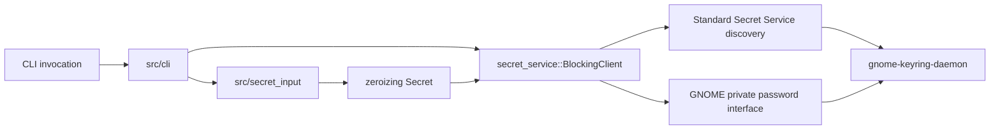

# gmellon implementation status

## Snapshot

As of 2026-09-12, `gmellon` is a working Rust CLI for headless GNOME Keyring
collection discovery, unlock, and password change. The default product backend
uses zbus to combine the standard Secret Service discovery API with GNOME's
private `org.gnome.keyring.InternalUnsupportedGuiltRiddenInterface` password
methods.

The CLI and backend have been exercised through the actual compiled binary
against a manually launched `gnome-keyring-daemon` on a private
`dbus-broker`. Tests use an exact `login` collection plus a second collection
with a distinct password. The integration harness epic and the `list`,
`unlock`, and `change` implementation tickets are closed.

The code is an MVP, not release-ready: password bodies currently use a plain
Secret Service session. `gmell-encrypted-session` is an explicit P1 release
blocker.

## Current CLI

```text
gmellon list
gmellon unlock [COLLECTION]
gmellon unlock [COLLECTION] --stdin
gmellon change [COLLECTION]
gmellon change [COLLECTION] --stdin
```

- Omitted collection IDs default directly to `login`; there is no configuration
  layer or environment-selected default.
- `list` renders deterministic `ID`, `LOCKED`, and escaped `LABEL` columns.
- `unlock --stdin` reads one LF/CRLF-terminated UTF-8 line.
- `change --stdin` reads current, new, and confirmation lines in that order.
- TTY mode uses `rpassword` against the controlling terminal with echo
  disabled.
- Missing collections are rejected before secret input is read.
- An already-unlocked collection returns success without reading or checking a
  password. Ordinary unlock never locks or relocks a collection.

### Exit behavior

| Code | Meaning |
| ---: | --- |
| 0 | Success, including an already-unlocked collection |
| 1 | Usage, input, missing collection, malformed reply, or unexpected local/D-Bus error |
| 2 | Collection password denied |
| 3 | GNOME's private password interface is unavailable |
| 4 | Session bus or GNOME Secret Service is unavailable |

## Product architecture



| Area | Path | Responsibility |
| --- | --- | --- |
| CLI | [`/src/cli/mod.rs`](/src/cli/mod.rs) | clap parsing, pre-input collection resolution, output, and exit mapping |
| Secret input | [`/src/secret_input/mod.rs`](/src/secret_input/mod.rs) | rpassword TTY prompts, bounded stdin records, confirmation, and zeroizing ownership |
| Collection client | [`/src/secret_service/`](/src/secret_service/) | collection IDs/metadata, generated zbus proxies, list/unlock/change, and remote-error classification |
| Historical control backend | [`/src/control/`](/src/control/) | login-only sans-I/O codec, peer validation, and synchronous control-socket exchange |
| Executable harness | [`/dev/harness/`](/dev/harness/) | control-only and private-broker daemon lifecycles, checks, cleanup, and retained evidence |
| Rust proofs | [`/tests/harness/`](/tests/harness/) | opt-in real-daemon transport, collection, binary CLI, and redaction proofs |

The zbus declarations generate blocking and asynchronous proxies from the same
interfaces. The product exposes `BlockingClient` today; a future Tokio adapter
can reuse the collection model and generated async proxies rather than wrapping
blocking I/O.

## Backend policy

| Backend | Status | Scope | Selection policy |
| --- | --- | --- | --- |
| GNOME private D-Bus collection backend | Implemented; default | Any collection exposed by `gnome-keyring-daemon` | Always used by the current CLI |
| Login control socket | Implemented but not yet feature-gated | Special `login` collection only | Planned disabled-by-default `login-control` Cargo feature; never automatic fallback |

The login control path has materially different semantics: UNLOCK and CHANGE
can create a missing login keyring, and an OK response cannot distinguish a
new unlock from an already-unlocked keyring. `gmell-login-control-feature`
tracks honest naming (`LoginControlClient`, `unlock_login`,
`change_login_password`), feature-gated dependencies/tests, and explicit CLI
selection if CLI access is retained.

## Implemented and validated behavior

### Collection backend

The maintained private-broker proof demonstrates:

- exact `login` plus a second persistent collection listed by stable D-Bus ID;
- distinct passwords per collection;
- wrong and cross-password denial while locked;
- correct password unlocking only its selected collection;
- missing-ID classification for unlock and change;
- `AlreadyUnlocked` without password input, verification, lock, or relock;
- password rotation followed by former-password denial and new-password
  success; and
- sibling collections remaining unaffected.

See [`collections0.glm53max.md`](/doc/harness/collections0.glm53max.md).

### Compiled CLI

The Rust proof invokes `env!("CARGO_BIN_EXE_gmellon")` inside the private
broker harness. It establishes deterministic listing, default and explicit
collection selection, stdin contracts, output text, exits 0/1/2, missing-ID
rejection before input, and already-unlocked success with `/dev/null` stdin.
Exits 3/4 are covered by pure error-mapping tests because killing the owned
daemon or broker is a harness failure.

See [`cli0.glm53max.md`](/doc/harness/cli0.glm53max.md) and
[`change0.glm53max.md`](/doc/harness/change0.glm53max.md).

### No-relock evidence

A match-filtered private-bus monitor observes standard `Service.Lock` calls.
Every observed call is counted and attributed to the separate fixture
connection; product client and CLI connections emit none. The absence of a
password call on an already-unlocked collection is additionally established by
the committed early-return code and by successful `--stdin` execution with
`/dev/null`, which would fail if read.

### Secret and artifact handling

- Owned CLI secrets use `Zeroizing<String>` and expose only borrowed bytes.
- Password-bearing control frames use zeroizing allocations.
- Secret types do not implement `Debug`, `Clone`, or `Display`.
- Stdin buffers preallocate their bounded 64 KiB capacity, avoiding abandoned
  prefix allocations in that reader.
- Input errors retain redacted kind/errno metadata rather than reader-provided
  text.
- Binary streams and retained regular artifacts are scanned for generated
  secrets; symlinks fail closed.
- The password-method proof monitor streams stdout through a pipe, retains only
  parsed header facts, and never writes decoded password bodies to disk.

These are best-effort process-memory guarantees. Dependency and allocator
copies cannot all be erased.

## Harness boundary

[`broker.py`](/dev/harness/broker.py) creates a unique mode-0700 scratch root,
a mode-0600 private session-bus socket, private HOME/XDG storage, a manually
launched daemon, and exact owned process topology. The private bus config has
no service directories; runtime `ListActivatableNames` contains only
`org.freedesktop.DBus`.

This is configuration/session isolation, not host independence or a security
sandbox. `dbus-broker-launch --scope=system` requires host systemd, journald,
and the real system bus for its launcher-controller subscription. The daemon
and tested command retain an unreachable scratch system-bus address and never
receive the real user session-bus address. Exact limitations and teardown
evidence are maintained in [`/doc/harness/README.md`](/doc/harness/README.md)
and [`broker0.gpt6a.md`](/doc/harness/broker0.gpt6a.md).

## Verification state

Ordinary development checks currently report:

```text
cargo nextest run
85 passed, 4 skipped
```

The four ignored tests are explicit external-daemon proofs rather than silent
passes. Maintained entry points fail with status 125 when their hard
prerequisites are absent:

```sh
dev/harness/check rust-nextest # control backend against real daemon
dev/harness/check rust-broker  # collection BlockingClient proof
dev/harness/check rust-cli     # compiled list/unlock/change proof
dev/harness/check broker       # private-broker lifecycle/interface suite
dev/harness/check all          # all maintained external checks
```

The completed wave also passed rustfmt, clippy with warnings denied, rustdoc,
Python compilation and focused suites, repeated private-broker runs, and the
aggregate harness check.

## Security and compatibility limits

1. **Unsupported GNOME API.** Collection password methods are deliberately
   internal and may change or disappear. The client reports missing private
   capability distinctly (exit 3).
2. **Plain MVP session.** Password bytes cross the user's D-Bus connection
   without Secret Service encryption; zbus, broker, and daemon copies are
   outside gmellon's zeroization control. `gmell-encrypted-session` blocks
   release and must implement/prove the standard
   `dh-ietf1024-sha256-aes128-cbc-pkcs7` session without silent plain fallback.
3. **Version-scoped daemon behavior.** Locked-collection password change and
   several fixture details are observed against `gnome-keyring-daemon` 48.0,
   not promised by the unsupported interface.
4. **TTY evidence boundary.** TTY behavior is covered through rpassword's
   injected-reader seam; maintained real-daemon binary proofs use `--stdin`.
5. **No automatic verification side effect.** Ordinary unlock never relocks.
   Any future lock-then-unlock verification mode must be explicit and warn
   about state changes.

## Open work

### Release blocker

- **`gmell-encrypted-session` (P1):** encrypted Secret Service password
  transport and private-broker proof. Plain CLI operation may continue, but the
  crate must not be published before this closes.

### Product follow-ups

- **`gmell-login-control-feature` (P3):** package the login-only control
  backend as an honest disabled-by-default Rust feature; no automatic fallback.
- **`gmell-polish` (P3):** needs rescoping from its obsolete offline-control
  status language to collection display, redacted diagnostics, completions,
  and final help.
- **`gmell-zimfw-plugin` (P3):** optional shell integration; must never prompt
  merely because a shell module loads.
- **`gmell-stretch` (P4):** needs rescoping now that zbus is the default and
  lock/relock is a sensitive explicit operation rather than basic symmetry.
- **`gmell-firmament-config` (P4, deferred):** Firmament is under active
  rebuild and no current configuration domain justifies adoption. The fixed
  default remains `login`; explicit collection IDs remain command arguments.

The parent `gmell-unlock-cli` epic remains open until release security and the
agreed packaging/polish boundary are complete.

## Durable decisions

- Use collection IDs, with `login` as the fixed omitted-argument default.
- Do not introduce configuration for a single default value.
- Never accept passwords through argv, environment, config, or retained
  evidence.
- Never lock/relock during ordinary unlock.
- Never silently fall back from zbus to the create-capable login control path.
- Keep sync product APIs today while preserving generated async zbus proxies
  and a future Tokio sibling implementation.

## Cross-references

- [`/README.md`](/README.md) is the user-facing product contract and usage
  entry point.
- [`/doc/harness/README.md`](/doc/harness/README.md) is the maintained harness
  operation and isolation guide.
- [`collections0.glm53max.md`](/doc/harness/collections0.glm53max.md) establishes
  arbitrary collection and exact-login backend behavior.
- [`cli0.glm53max.md`](/doc/harness/cli0.glm53max.md) establishes compiled
  `list` and `unlock` behavior.
- [`change0.glm53max.md`](/doc/harness/change0.glm53max.md) establishes compiled
  `change` behavior and never-on-disk password-method monitoring.
