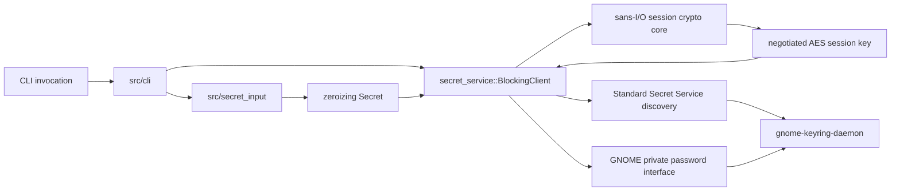

# gmellon implementation status

## Snapshot

As of 2026-09-13, `gmellon` is a working Rust CLI for headless GNOME Keyring
collection discovery, unlock, and password change. The default product backend
uses zbus to combine the standard Secret Service discovery API with GNOME's
private `org.gnome.keyring.InternalUnsupportedGuiltRiddenInterface` password
methods, and every connection negotiates the standard encrypted Secret
Service session (`dh-ietf1024-sha256-aes128-cbc-pkcs7`) — passwords never
cross the bus in the clear, with no plain-session fallback. The
`gmell-encrypted-session` release blocker is closed with body-scan monitor
evidence.

The CLI and backend have been exercised through the actual compiled binary
against a manually launched `gnome-keyring-daemon` on a private
`dbus-broker`. Tests use an exact `login` collection plus a second collection
with a distinct password. The integration harness epic and the `list`,
`unlock`, `change`, and encrypted-session implementation tickets are closed.
The historical login-only control backend is retained as library-only
machinery behind the disabled-by-default `login-control` Cargo feature.

The code remains an MVP in polish terms — no configuration layer, no
completions, diagnostics are `eprintln`-based — but no release blocker
remains open. Shell integration ships as the self-contained
[`zimfw/`](/zimfw) zsh module: it exports a validated `SSH_AUTH_SOCK`
(override > existing > GNOME/GCR discovery) without ever prompting or
touching systemctl on load.

## Current CLI

```text
gmellon list
gmellon status
gmellon unlock [COLLECTION]
gmellon unlock [COLLECTION] --stdin
gmellon change [COLLECTION]
gmellon change [COLLECTION] --stdin
gmellon completions SHELL
gmellon -v [COMMAND]   # redacted diagnostics on stderr
```

- Omitted collection IDs default directly to `login`; there is no configuration
  layer or environment-selected default.
- `list` renders deterministic `ID`, `LOCKED`, and escaped `LABEL` columns.
- `status` is a prompt-free health report: service reachability, encrypted
  session capability, private-interface presence (read-only Introspect probe,
  never a password method), and a lock summary consistent with `list`. It
  never prompts, unlocks, or locks.
- `unlock --stdin` reads one LF/CRLF-terminated UTF-8 line.
- `change --stdin` reads current, new, and confirmation lines in that order.
- `-v` installs a stderr-only tracing subscriber emitting operation, result,
  and length events; scalar fields only, never secret bytes or key material.
- `completions` writes scripts for zsh, bash, elvish, fish, and powershell;
  the zimfw module regenerates `functions/_gmellon` automatically.
- TTY mode uses `rpassword` against the controlling terminal with echo
  disabled.
- Missing collections are rejected before secret input is read.
- An already-unlocked collection returns success without reading or checking a
  password. Ordinary unlock never locks or relocks a collection.

### Exit behavior

| Code | Meaning |
| ---: | --- |
| 0 | Success, including an already-unlocked collection |
| 1 | Usage, input, missing collection, malformed reply, encrypted-session failure, or unexpected local/D-Bus error |
| 2 | Collection password denied |
| 3 | GNOME's private password interface is unavailable |
| 4 | Session bus or GNOME Secret Service is unavailable |

The encrypted-session failures stay in the exit-1 family with distinct
messages: a service that rejects the DH algorithm reports
`EncryptedSessionUnsupported` ("does not support encrypted sessions …
refusing to fall back to a plain session"), and cryptography failures
(randomness, peer key, derivation, sealing) report
`Session(CryptoError)`. The 0–4 table itself is unchanged.

## Product architecture



| Area | Path | Responsibility |
| --- | --- | --- |
| CLI | [`/src/cli/mod.rs`](/src/cli/mod.rs) | clap parsing, pre-input collection resolution, output, and exit mapping |
| Secret input | [`/src/secret_input/mod.rs`](/src/secret_input/mod.rs) | rpassword TTY prompts, bounded stdin records, confirmation, and zeroizing ownership |
| Session crypto core | [`/src/secret_service/session.rs`](/src/secret_service/session.rs) | sans-I/O encrypted-session cryptography: DH keypair, peer-key validation, HKDF-SHA256 key derivation, AES-128-CBC/PKCS#7 sealing, zeroized key material |
| Collection client | [`/src/secret_service/`](/src/secret_service/) | encrypted-session negotiation, collection IDs/metadata, generated zbus proxies, list/unlock/change, and remote-error classification |
| Historical control backend | [`/src/control/`](/src/control/) | login-only sans-I/O codec, peer validation, and synchronous control-socket exchange behind the disabled-by-default `login-control` feature |
| Executable harness | [`/dev/harness/`](/dev/harness/) | control-only and private-broker daemon lifecycles, checks, cleanup, and retained evidence |
| Rust proofs | [`/tests/harness/`](/tests/harness/) | opt-in real-daemon transport, collection, binary CLI, encrypted-session wire, and redaction proofs |
| Zsh integration | [`/zimfw/`](/zimfw/) | zimfw module: idempotent SSH_AUTH_SOCK selection (override > existing > gcr/keyring discovery) with an opt-in systemd user-environment publisher; never prompts, never unlocks, never runs systemctl on load |

The zbus declarations generate blocking and asynchronous proxies from the same
interfaces. The product exposes `BlockingClient` today; a future Tokio adapter
can reuse the collection model, the generated async proxies, and the sans-I/O
session crypto core (which contains no zbus or I/O types) rather than wrapping
blocking I/O.

## Backend policy

| Backend | Status | Scope | Selection policy |
| --- | --- | --- | --- |
| GNOME private D-Bus collection backend | Implemented; default | Any collection exposed by `gnome-keyring-daemon` | Always used by the current CLI |
| Login control socket | Implemented; feature-gated behind `login-control`, disabled by default, library-only | Special `login` collection only | Opt-in Cargo feature; never automatic fallback |

The login control path has materially different semantics: UNLOCK and CHANGE
can create a missing login keyring, and an OK response cannot distinguish a
new unlock from an already-unlocked keyring. `gmell-login-control-feature`
delivered the honest packaging: `LoginControlClient` with `unlock_login` and
`change_login_password`, `LoginControlError`, feature-gated dependencies and
tests, and no CLI surface — there is no backend-selection flag and no fallback
code, so "never automatic fallback" holds structurally.

## Implemented and validated behavior

### Collection backend

The maintained private-broker proof demonstrates:

- exact `login` plus a second persistent collection listed by stable D-Bus ID;
- distinct passwords per collection;
- wrong and cross-password denial while locked;
- correct password unlocking only its selected collection;
- missing-ID classification for unlock and change;
- `AlreadyUnlocked` without password input, verification, lock, or relock;
- password rotation followed by former-password denial and new-password
  success; and
- sibling collections remaining unaffected.

See [`collections0.glm53max.md`](/doc/harness/collections0.glm53max.md).

### Encrypted session

Every `BlockingClient` connection negotiates the standard encrypted Secret
Service session `dh-ietf1024-sha256-aes128-cbc-pkcs7`
([`src/secret_service/session.rs`](/src/secret_service/session.rs)):

- a fresh 1024-bit MODP (RFC 2409) Diffie-Hellman keypair per connection,
  private exponent below `p/2` and zeroized on drop, public key sent as the
  minimal unsigned big-endian `ay` OpenSession variant;
- the daemon's public key is validated (`1 < y < p-1`, at most the prime's
  byte length) before a constant-time Montgomery-ladder modpow;
- the shared secret is left-padded to the 128-byte prime length before
  HKDF-SHA256 (empty salt and info) derives the AES-128 key — the
  normalization both peers require;
- each password is sealed with a fresh random IV and PKCS#7 padding (a full
  block on 16-byte multiples), traveling as the Secret tuple's
  `parameters`/`value` fields.

The first live handshake against the manually launched daemon succeeded
without adjustment: the variant shape, minimal encoding, normalization,
HKDF configuration, and seal were all correct as implemented, and the
existing unlock/change proofs passed unchanged over the encrypted session.
The daemon performs no client-public-key validation of its own (it answered
a probe with a 3-byte "public key"); gmellon's validator stays strict.

Wire evidence is a body-scanning bus monitor
([`tests/harness/broker_common.rs`](/tests/harness/broker_common.rs)) that
captures every member of the private password interface plus every
OpenSession negotiation: it scans each raw line and each reconstructed `ay`
run (through a pipe, one zeroized run at a time, never on disk) for the
generated passwords — none appear in any body — and verdicts each captured
call's encrypted shape (16-byte IV plus non-empty 16-multiple ciphertext
per Secret, by member arity) and each negotiation's DH algorithm string,
so a plain secret or plain negotiation fails instead of passing vacuously.
Both broker proofs assert exact counts: the collection proof pins two
encrypted fixture creations, six product unlocks, one change, and the
fixture-plus-client negotiations; the CLI proof pins eleven binary
unlocks, three changes (cross-checked against the header monitor), and one
encrypted OpenSession per CLI invocation. The test fixture negotiates the
same encrypted session, so even fixture creations never carry plaintext.

See [`session0.gpt6a.md`](/doc/harness/session0.gpt6a.md).

### Compiled CLI

The Rust proof invokes `env!("CARGO_BIN_EXE_gmellon")` inside the private
broker harness. It establishes deterministic listing, default and explicit
collection selection, stdin contracts, output text, exits 0/1/2, missing-ID
rejection before input, and already-unlocked success with `/dev/null` stdin.
Exits 3/4 are covered by pure error-mapping tests because killing the owned
daemon or broker is a harness failure.

See [`cli0.glm53max.md`](/doc/harness/cli0.glm53max.md) and
[`change0.glm53max.md`](/doc/harness/change0.glm53max.md).

### No-relock evidence

A match-filtered private-bus monitor observes standard `Service.Lock` calls.
Every observed call is counted and attributed to the separate fixture
connection; product client and CLI connections emit none. The absence of a
password call on an already-unlocked collection is additionally established by
the committed early-return code and by successful `--stdin` execution with
`/dev/null`, which would fail if read.

### Secret and artifact handling

- Owned CLI secrets use `Zeroizing<String>` and expose only borrowed bytes.
- Password-bearing control frames use zeroizing allocations.
- Secret types do not implement `Debug`, `Clone`, or `Display`.
- Session key material — DH private exponent, shared secret, padded IKM,
  AES key, per-Secret IV, and padded plaintext — lives in zeroizing
  allocations in the session core.
- Stdin buffers preallocate their bounded 64 KiB capacity, avoiding abandoned
  prefix allocations in that reader.
- Input errors retain redacted kind/errno metadata rather than reader-provided
  text.
- Binary streams and retained regular artifacts are scanned for generated
  secrets; symlinks fail closed.
- The password-method proof monitors stream stdout through pipes, retain only
  parsed header/length/verdict facts, and never write decoded password
  bodies to disk.

These are best-effort process-memory guarantees. Dependency and allocator
copies cannot all be erased.

## Harness boundary

[`broker.py`](/dev/harness/broker.py) creates a unique mode-0700 scratch root,
a mode-0600 private session-bus socket, private HOME/XDG storage, a manually
launched daemon, and exact owned process topology. The private bus config has
no service directories; runtime `ListActivatableNames` contains only
`org.freedesktop.DBus`.

This is configuration/session isolation, not host independence or a security
sandbox. `dbus-broker-launch --scope=system` requires host systemd, journald,
and the real system bus for its launcher-controller subscription. The daemon
and tested command retain an unreachable scratch system-bus address and never
receive the real user session-bus address. Exact limitations and teardown
evidence are maintained in [`/doc/harness/README.md`](/doc/harness/README.md)
and [`broker0.gpt6a.md`](/doc/harness/broker0.gpt6a.md).

## Verification state

Ordinary development checks currently report:

```text
cargo nextest run
90 passed, 2 skipped
cargo nextest run --features login-control
117 passed, 4 skipped
```

The zsh module suite reports independently:

```text
zimfw/test.zsh
68 assertions passed, 0 failed
```

The suite uses real AF_UNIX socket fixtures and a recording `systemctl`
stub; the module was additionally installed and loaded end-to-end through
the real zimfw from the archived upstream checkout (absolute-path `zmodule`
form; the generated `init.zsh` sources `zimfw/init.zsh` by default
discovery, no `--source` needed).

The login control backend is omitted entirely from default builds (its
unit tests and the `real_daemon` target compile only with the feature), so
the default baseline dropped from the earlier 106 passed / 4 skipped; the
two remaining skips are the private-broker proofs. The full historical set
returns with the feature:

```text
cargo nextest run --features login-control
106 passed, 4 skipped
```

The four ignored tests are explicit external-daemon proofs rather than silent
passes. Maintained entry points fail with status 125 when their hard
prerequisites are absent:

```sh
dev/harness/check rust-nextest # control backend against real daemon (passes --features login-control)
dev/harness/check rust-broker  # collection BlockingClient proof, encrypted-session wire evidence
dev/harness/check rust-cli     # compiled list/unlock/change proof, encrypted-session wire evidence
dev/harness/check broker       # private-broker lifecycle/interface suite
dev/harness/check all          # all maintained external checks
```

The encrypted-session wave's maintained results: `rust-nextest` 2/2,
`rust-broker` 1/1, `rust-cli` 1/1, `broker` 7/7 plus the private-bus probe,
the control-only Python suites, and the aggregate `dev/harness/check all` —
all passing, with the ordinary suite's four baseline skips unchanged. The
wave also passed rustfmt, clippy with warnings denied, and warning-free
rustdoc.

## Security and compatibility limits

1. **Unsupported GNOME API.** Collection password methods are deliberately
   internal and may change or disappear. The client reports missing private
   capability distinctly (exit 3).
2. **Residual exposure of encrypted transport.** Passwords cross the bus as
   ciphertext only, but the D-Bus daemon and broker still see message
   metadata (paths, algorithm, lengths) and handle the ciphertext itself;
   their copies are outside gmellon's control. The spec-mandated
   `dh-ietf1024-sha256-aes128-cbc-pkcs7` session uses the dated RFC 2409
   1024-bit MODP group and AES-128-CBC rather than an AEAD — fresh
   per-connection exponents and per-Secret IVs are the mitigations the
   protocol offers, and gmellon adds strict peer-public-key validation the
   daemon itself lacks.
3. **Version-scoped daemon behavior.** Locked-collection password change and
   several fixture details are observed against `gnome-keyring-daemon` 48.0,
   not promised by the unsupported interface.
4. **TTY evidence boundary.** TTY behavior is covered through rpassword's
   injected-reader seam; maintained real-daemon binary proofs use `--stdin`.
5. **No automatic verification side effect.** Ordinary unlock never relocks.
   Any future lock-then-unlock verification mode must be explicit and warn
   about state changes.

## Open work

No release blocker remains open. The packaging boundary (`gmell-polish`) is
complete: status report, redacted `-v` diagnostics, completions (including
the zimfw module's automatic regeneration), and the help-text pass all
landed with proof coverage.

### Product follow-ups

- **`gmell-stretch` (P4):** explicit `lock` subcommand (standard
  `Service.Lock`, fail-closed on prompt objects) and the opt-in zsh
  login-hook documentation pattern.
- **`gmell-firmament-config` (P4, deferred):** Firmament is under active
  rebuild and no current configuration domain justifies adoption. The fixed
  default remains `login`; explicit collection IDs remain command arguments.

The parent `gmell-unlock-cli` epic's declared boundary — release security
plus packaging/polish — is complete.

## Durable decisions

- Use collection IDs, with `login` as the fixed omitted-argument default.
- Do not introduce configuration for a single default value.
- Never accept passwords through argv, environment, config, or retained
  evidence.
- Never lock/relock during ordinary unlock.
- Negotiate the encrypted Secret Service session on every connection and
  never fall back to a plain session; an algorithm-rejecting service fails
  distinctly.
- Never silently fall back from zbus to the create-capable login control path.
- Keep sync product APIs today while preserving generated async zbus proxies,
  the sans-I/O session crypto core, and a future Tokio sibling implementation.

## Cross-references

- [`/README.md`](/README.md) is the user-facing product contract and usage
  entry point.
- [`/doc/harness/README.md`](/doc/harness/README.md) is the maintained harness
  operation and isolation guide.
- [`collections0.glm53max.md`](/doc/harness/collections0.glm53max.md) establishes
  arbitrary collection and exact-login backend behavior.
- [`cli0.glm53max.md`](/doc/harness/cli0.glm53max.md) establishes compiled
  `list` and `unlock` behavior.
- [`change0.glm53max.md`](/doc/harness/change0.glm53max.md) establishes compiled
  `change` behavior and never-on-disk password-method monitoring.
- [`session0.gpt6a.md`](/doc/harness/session0.gpt6a.md) establishes the
  encrypted-session implementation, first-live-run interop facts, and the
  body-scan monitor proof that passwords travel only as ciphertext.
- [`/zimfw/README.md`](/zimfw/README.md) is the maintained guide for the
  zsh module: install line, selection policy, and the opt-in systemd
  publisher.
